# TRƯỜNG ĐẠI HỌC CÔNG NGHỆ THÔNG TIN, ĐHQG-HCM
## KHOA MẠNG MÁY TÍNH VÀ TRUYỀN THÔNG
---

# BÁO CÁO THỰC HÀNH CHI TIẾT
## MÔN HỌC: MẬT MÃ HỌC VÀ ỨNG DỤNG (NT219)
### CHƯƠNG TRÌNH THỰC HÀNH 6 BÀI LAB (LABS 1–6)

---

# LAB 2: TỰ CÀI ĐẶT AES-128 VÀ CHẾ ĐỘ DÒNG CTR TỪ ĐẦU BẰNG C++17
### Hiện thực Chuẩn NIST FIPS-197, NIST SP 800-38A, Kiểm chứng Độc lập với OpenSSL, Đánh giá Hiệu năng Đa Nền tảng và Phân tích Kênh kề (Cache-Timing)

---

**Thông tin sinh viên thực hiện:**
- **Họ và tên:** Sinh viên NT219
- **Mã số sinh viên (MSSV):** 25521710
- **Lớp học phần:** NT219.P11.MMTT
- **Giảng viên hướng dẫn / TA:** Giảng viên Bộ môn An toàn Thông tin
- **Mã nguồn / Archive nộp bài:** `25521710.All6labs.rar`
- **Thời gian hoàn thành:** Học kỳ I - Năm học 2026–2027
- **Tập tin báo cáo Markdown:** [report.md](file:///d:/UIT/NT219/crypto-labs/lab2/docs/report.md)
- **Thư mục dự án:** [lab2/](file:///d:/UIT/NT219/crypto-labs/lab2/)

---

## LỜI CAM KẾT LIÊM CHÍNH HỌC THUẬT

1. Tôi cam kết toàn bộ mã nguồn thuật toán lõi AES-128, chế độ dòng Counter (CTR), cấu hình hệ thống xây dựng CMake, các kịch bản kiểm thử (unit test với Catch2, KAT runner, negative tests), các kịch bản tự động hóa và các phép đo hiệu năng thực nghiệm trong bài lab này được tôi tự thực hiện nghiêm túc, trung thực.
2. **Tuân thủ tuyệt đối ràng buộc không dùng thư viện ngoài trong lõi mật mã:** Toàn bộ nguyên thủy mật mã của AES-128 (KeyExpansion, SubBytes, ShiftRows, MixColumns, AddRoundKey) và chế độ CTR được lập trình thuần túy từ đầu (*from scratch*) bằng ngôn ngữ C++17 chuẩn (chỉ sử dụng C++ Standard Template Library - STL). Tuyệt đối **không sử dụng bất kỳ thư viện mật mã bên ngoài nào** (như OpenSSL, Crypto++, libsodium...) trong phần cài đặt thuật toán mã hóa/giải mã của chương trình `aestool`. Thư viện OpenSSL chỉ được liên kết ngoài như một công cụ đối chứng độc lập (*reference implementation*) phục vụ mục đích kiểm chứng chéo (*cross-validation*) và đo lường so sánh hiệu năng thực nghiệm theo đúng quy định của đề bài.
3. Mọi tài liệu đặc tả tiêu chuẩn (NIST FIPS-197, NIST SP 800-38A, NIST AESAVS) và các công trình khoa học tham khảo liên quan đến tấn công kênh kề (Cache-Timing Attacks của Bernstein, Osvik-Shamir-Tromer) đều được trích dẫn nguồn gốc học thuật minh bạch và đầy đủ trong báo cáo.
4. Mọi thí nghiệm kiểm thử âm (negative tests), tấn công sai khóa, sai IV, tấn công uốn nắn bản mã (ciphertext tampering/malleability), tấn công tái sử dụng keystream (two-time pad) đều chỉ được thực nghiệm cục bộ trên tập dữ liệu kiểm thử giả lập tự tạo trong môi trường an toàn ngoại tuyến (offline), không gây ảnh hưởng đến bất kỳ hệ thống thông tin nào.
5. Mọi khóa bí mật (keys), vector khởi tạo (IV), chuỗi dữ liệu xuất hiện trong mã nguồn, tập tin JSON KAT và báo cáo này hoàn toàn chỉ mang tính minh họa học thuật, không phải là khóa bí mật của bất kỳ hệ thống thực tế nào.

---

## KHAI BÁO HỖ TRỢ CÔNG CỤ VÀ TRÍ TUỆ NHÂN TẠO (AI)

- **Công cụ phần mềm và biên dịch:** Trình biên dịch Microsoft Visual C++ 2022 (MSVC x64 v143), GCC 13.x/16.x (MinGW-w64 trên Windows và native trên Ubuntu LTS), Clang/LLVM, CMake 3.20+, Python 3 (Matplotlib, Pandas để vẽ biểu đồ và tổng hợp thống kê).
- **Phạm vi sử dụng trợ lý Trí tuệ Nhân tạo (AI):** AI được sử dụng có kiểm soát để hỗ trợ rà soát văn phong kỹ thuật, tối ưu hóa định dạng Markdown/LaTeX, gợi ý cấu trúc báo cáo bám sát rubric chấm điểm của môn học, và kiểm tra tính nhất quán của các bảng số liệu thực nghiệm.
- **Trách nhiệm của tác giả:** Toàn bộ thuật toán trong [src/aes128.cpp](file:///d:/UIT/NT219/crypto-labs/lab2/src/aes128.cpp), [src/ctr.cpp](file:///d:/UIT/NT219/crypto-labs/lab2/src/ctr.cpp), bộ sinh IV trong [src/util.cpp](file:///d:/UIT/NT219/crypto-labs/lab2/src/util.cpp), parser JSON trong [src/json.cpp](file:///d:/UIT/NT219/crypto-labs/lab2/src/json.cpp), bộ dữ liệu đo benchmark thực tế trên cả hai hệ điều hành Windows và Linux (lưu trữ trong [Output/](file:///d:/UIT/NT219/crypto-labs/lab2/Output/)) đều được chạy thực nghiệm trên phần cứng máy tính của tác giả. Tác giả đã trực tiếp phân tích, đối chiếu và chịu trách nhiệm toàn bộ về tính chính xác của các phân tích toán học, mật mã học và số liệu thực nghiệm trong báo cáo này.

---

## BẢNG TỰ ĐÁNH GIÁ ĐIỂM SỐ (RUBRIC SELF-ASSESSMENT)

Căn cứ theo thang điểm 100 quy định trong đề bài và [require.md](file:///d:/UIT/NT219/crypto-labs/lab2/require.md):

| STT | Hạng mục đánh giá | Điểm tối đa | Tự chấm | Minh chứng cụ thể trong báo cáo |
| :---: | :--- | :---: | :---: | :--- |
| 1 | **Lõi AES-128 đúng FIPS-197** | **30** | 30/30 | **Mục 2.3, 4.1, 4.4, Phụ lục P2**: Cài đặt thuần C++ đầy đủ `SubBytes` (3 backend), `ShiftRows`, `MixColumns`, `AddRoundKey`, `KeyExpansion` (10 vòng). Vượt qua 100% vector FIPS-197 App. B, App. C.1, AESAVS và kiểm tra lịch khóa App. A.1 trên cả 3 backend S-box. |
| 2 | **Chế độ CTR đúng chuẩn** | **15** | 15/15 | **Mục 2.4, 3.3, 4.1, 4.4**: Tuân thủ NIST SP 800-38A §6.5; xử lý độ dài tùy ý, không padding, khối cuối lẻ chính xác. Tài liệu hóa rõ ràng counter 128-bit big-endian, lan truyền carry, và cơ chế fail-closed chặn đứng tràn counter (exit 5). |
| 3 | **KAT & Cross-validation** | **15** | 15/15 | **Mục 4.1, 4.2, 4.3, 4.4**: Lệnh `--kat vectors.json` in PASS/FAIL từng ca và tổng kết (21/21 passed); lệnh `xval --ref openssl` khớp 100% với OpenSSL (66/66 ca và 200/200 ca); lệnh CLI đối chiếu `openssl enc` và `fc /b` trùng khít nhị phân tuyệt đối; bộ negative tests toàn diện. |
| 4 | **Chất lượng kỹ thuật & Tài liệu** | **10** | 10/10 | **Mục 2.2, 2.5, 3.5, Phụ lục P1, P2**: Cấu hình CMake out-of-source chuẩn mực; biên dịch sạch và vượt qua 100% `ctest` trên cả Windows (MSVC & MinGW) và Ubuntu (GCC & Clang); README chi tiết; kiến trúc xử lý lỗi fail-closed triệt để; có sẵn binary đóng gói cho cả 2 hệ điều hành. |
| 5 | **Đánh giá Hiệu năng** | **10** | 10/10 | **Mục 5, Phụ lục P4**: Giao thức đo chuẩn xác (warm-up 1.5s, $N \ge 30$ đến $N=500$ lần chạy độc lập); đầy đủ kích thước 1 MiB, 100 MiB, 1 GiB; báo cáo đầy đủ Mean, Median, SD, CI 95%; đồ thị có error bar; bảng cấu hình phần cứng; phân tích sâu 4 khía cạnh so sánh bắt buộc. |
| 6 | **Thảo luận Bảo mật** | **20** | 20/20 | **Mục 3, Mục 6**: Phân tích chuyên sâu rò rỉ timing S-box dạng bảng và tấn công cache trên T-table; vai trò của constant-time; thảm họa two-time pad do tái dùng IV; tính uốn nắn (malleability) của CTR và sự cần thiết của MAC/AEAD; lợi thế bảo mật của AES-NI; threat model và giới hạn cài đặt. |
| **CỘNG** | **TỔNG ĐIỂM CHÍNH THỨC** | **100** | **100/100** | **Đáp ứng toàn diện và xuất sắc 100% tiêu chí đề bài quy định.** |
| *Bonus* | *Mở rộng nâng cao (AES-192/256, XTS, AES-NI / GUI)* | *+20* | *+3* | **Mục 8.2, [gui/aestool_gui.py](file:///d:/UIT/NT219/crypto-labs/lab2/gui/aestool_gui.py)**: Đã hoàn thiện giao diện đồ họa PyQt6 chuyên nghiệp; phân tích lộ trình thiết kế toán học chi tiết cho AES-192/256, AES-XTS và AES-NI. |

---

# MỤC LỤC CHI TIẾT

- [1. Mục tiêu và Chuẩn đầu ra](#1-mục-tiêu-và-chuẩn-đầu-ra)
  - [1.1. Mục tiêu đào tạo của bài Lab 2](#11-mục-tiêu-đào-tạo-của-bài-lab-2)
  - [1.2. Ràng buộc kỹ thuật nghiêm ngặt](#12-ràng-buộc-kỹ-thuật-nghiêm-ngặt)
  - [1.3. Phạm vi thuật toán và các tính năng cốt lõi](#13-phạm-vi-thuật-toán-và-các-tính-năng-cốt-lõi)
- [2. Thiết kế Kiến trúc và Cài đặt Hệ thống](#2-thiết-kế-kiến-trúc-và-cài-đặt-hệ-thống)
  - [2.1. Kiến trúc phân tầng phần mềm](#21-kiến-trúc-phân-tầng-phần-mềm)
  - [2.2. Cấu trúc thư mục và Hệ thống Build CMake Out-of-Source](#22-cấu-trúc-thư-mục-và-hệ-thống-build-cmake-out-of-source)
  - [2.3. Chi tiết cài đặt Lõi AES-128 thuần C++ (FIPS-197)](#23-chi-tiết-cài-đặt-lõi-aes-128-thuần-c-fips-197)
    - [2.3.1. Cấu trúc State Matrix và Mô hình dữ liệu](#231-cấu-trúc-state-matrix-và-mô-hình-dữ-liệu)
    - [2.3.2. Ba Backend S-Box: Đánh đổi Hiệu năng - Bộ nhớ - An toàn](#232-ba-backend-s-box-đánh-đổi-hiệu-năng---bộ-nhớ---an-toàn)
    - [2.3.3. Phép biến đổi ShiftRows và InvShiftRows](#233-phép-biến-đổi-shiftrows-và-invshiftrows)
    - [2.3.4. Phép biến đổi MixColumns và InvMixColumns trên trường $GF(2^8)$](#234-phép-biến-đổi-mixcolumns-và-invmixcolumns-trên-trường-gf28)
    - [2.3.5. Thuật toán Lịch sinh khóa (KeyExpansion)](#235-thuật-toán-lịch-sinh-khóa-keyexpansion)
  - [2.4. Chi tiết cài đặt Chế độ CTR (NIST SP 800-38A)](#24-chi-tiết-cài-đặt-chế-độ-ctr-nist-sp-800-38a)
    - [2.4.1. Đặc tả Khối Counter và Quy tắc Big-Endian](#241-đặc-tả-khối-counter-và-quy-tắc-big-endian)
    - [2.4.2. Cơ chế sinh Keystream và Mã hóa/Giải mã Không Padding](#242-cơ-chế-sinh-keystream-và-mã-hóagiải-mã-không-padding)
    - [2.4.3. Kiến trúc Streaming File I/O Xử lý Tệp Đa-GiB](#243-kiến-trúc-streaming-file-io-xử-lý-tệp-đa-gib)
  - [2.5. Thiết kế Giao diện Dòng lệnh (CLI) và Quản trị Khóa/IV](#25-thiết-kế-giao-diện-dòng-lệnh-cli-và-quản-trị-khóaiv)
    - [2.5.1. Bảng tham số và Đặc tả mã thoát (Exit Codes)](#251-bảng-tham-số-và-đặc-tả-mã-thoát-exit-codes)
    - [2.5.2. Quản lý Vector Khởi tạo (IV) và Cơ chế Sidecar Tự động](#252-quản-lý-vector-khởi-tạo-iv-và-cơ-chế-sidecar-tự-động)
    - [2.5.3. Xử lý An toàn Mã ký tự Unicode UTF-8 trên Đa Nền tảng](#253-xử-lý-an-toàn-mã-ký-tự-unicode-utf-8-trên-đa-nền-tảng)
- [3. Thiết kế An toàn và Cơ chế Chống Dùng Sai (Misuse Resistance)](#3-thiết-kế-an-toàn-và-cơ-chế-chống-dùng-sai-misuse-resistance)
  - [3.1. Mô hình Đe dọa (Threat Model) và Kịch bản Rủi ro](#31-mô-hình-đe-dọa-threat-model-và-kịch-bản-rủi-ro)
  - [3.2. Quy tắc Bất biến: Tính Duy nhất của Cặp (Key, IV)](#32-quy-tắc-bất-biến-tính-duy-nhất-của-cặp-key-iv)
  - [3.3. Cơ chế Chặn Tràn Bộ đếm Counter (Counter Overflow Prevention)](#33-cơ-chế-chặn-tràn-bộ-đếm-counter-counter-overflow-prevention)
  - [3.4. Cơ chế Bảo vệ Chống Ghi đè Tệp (Overwrite Protection)](#34-cơ-chế-bảo-vệ-chống-ghi-đè-tệp-overwrite-protection)
  - [3.5. Triết lý Thiết kế Thất bại An toàn (Fail-Closed Architecture)](#35-triết-lý-thiết-kế-thất-bại-an-toàn-fail-closed-architecture)
- [4. Phương pháp và Kết quả Kiểm chứng (Verification & Testing)](#4-phương-pháp-và-kết-quả-kiểm-chứng-verification--testing)
  - [4.1. Bộ Vector Kiểm thử Mẫu Chính thức (NIST Known Answer Tests - KAT)](#41-bộ-vector-kiểm-thử-mẫu-chính-thức-nist-known-answer-tests---kat)
  - [4.2. Cài đặt và Vận hành Trình Kiểm thử KAT Runner Độc lập](#42-cài-đặt-và-vận-hành-trình-kiểm-thử-kat-runner-độc-lập)
  - [4.3. Kiểm chứng Chéo Độc lập với OpenSSL (Cross-Validation)](#43-kiểm-chứng-chéo-độc-lập-với-openssl-cross-validation)
  - [4.4. Kiểm thử Âm (Negative Testing) và Tính Toàn vẹn Bản mã](#44-kiểm-thử-âm-negative-testing-và-tính-toàn-vẹn-bản-mã)
    - [4.4.1. Kiểm thử từ chối Khóa và IV sai độ dài](#441-kiểm-thử-từ-chối-khóa-và-iv-sai-độ-dài)
    - [4.4.2. Kiểm thử Sai Khóa và Sai IV trong Giải mã](#442-kiểm-thử-sai-khóa-và-sai-iv-trong-giải-mã)
    - [4.4.3. Thí nghiệm Sửa đổi Bản mã và Tính Uốn nắn (Malleability)](#443-thí-nghiệm-sửa-đổi-bản-mã-và-tính-uốn-nắn-malleability)
  - [4.5. Kiểm thử Đơn vị Tự động với Catch2 và Tích hợp CTest](#45-kiểm-thử-đơn-vị-tự-động-với-catch2-và-tích-hợp-ctest)
  - [4.6. Kiểm thử Xử lý Tệp Lớn và Tính Toàn vẹn Vòng lặp (1 GiB Round-Trip)](#46-kiểm-thử-xử-lý-tệp-lớn-và-tính-toàn-vẹn-vòng-lặp-1-gib-round-trip)
- [5. Đánh giá Hiệu năng Thực nghiệm (Performance Benchmarking)](#5-đánh-giá-hiệu-năng-thực-nghiệm-performance-benchmarking)
  - [5.1. Môi trường Phần cứng và Hệ thống Đo lường](#51-môi-trường-phần-cứng-và-hệ-thống-đo-lường)
  - [5.2. Giao thức Đo lường và Phương pháp Xử lý Thống kê](#52-giao-thức-đo-lường-và-phương-pháp-xử-lý-thống-kê)
  - [5.3. Bảng Số liệu Thực nghiệm Tổng hợp](#53-bảng-số-liệu-thực-nghiệm-tổng-hợp)
  - [5.4. Trực quan hóa Dữ liệu bằng Biểu đồ Chuyên dụng](#54-trực-quan-hóa-dữ-liệu-bằng-biểu-đồ-chuyên-dụng)
  - [5.5. Phân tích Chuyên sâu 4 So sánh Bắt buộc](#55-phân-tích-chuyên-sâu-4-so-sánh-bắt-buộc)
    - [5.5.1. So sánh Ba Backend S-Box: Table vs. T-Table vs. Computed](#551-so-sánh-ba-backend-s-box-table-vs-t-table-vs-computed)
    - [5.5.2. So sánh Lõi Tự cài đặt với OpenSSL (Tăng tốc Phần cứng AES-NI)](#552-so-sánh-lõi-tự-cài-đặt-với-openssl-tăng-tốc-phần-cứng-aes-ni)
    - [5.5.3. So sánh Đa Nền tảng: Linux (Ubuntu GCC) vs. Windows (MSVC)](#553-so-sánh-đa-nền-tảng-linux-ubuntu-gcc-vs-windows-msvc)
    - [5.5.4. So sánh Chiều Mã hóa (Encrypt) và Giải mã (Decrypt)](#554-so-sánh-chiều-mã-hóa-encrypt-và-giải-mã-decrypt)
  - [5.6. Phân tích Dưới góc độ Kiến trúc Máy tính và Vi xử lý](#56-phân-tích-dưới-góc-độ-kiến-trúc-máy-tính-và-vi-xử-lý)
    - [5.6.1. Dung lượng Bộ nhớ và Hành vi Bộ nhớ đệm (Cache Footprint & Lines)](#561-dung-lượng-bộ-nhớ-và-hành-vi-bộ-nhớ-đệm-cache-footprint--lines)
    - [5.6.2. Ảnh hưởng của Bộ dự đoán Rẽ nhánh (Branch Prediction)](#562-ảnh-hưởng-của-bộ-dự-đoán-rẽ-nhánh-branch-prediction)
- [6. Phân tích Kỹ thuật An toàn Mật mã (Security Deep-Dive)](#6-phân-tích-kỹ-thuật-an-toàn-mật-mã-security-deep-dive)
  - [6.1. Rò rỉ Kênh kề trong Lõi AES: Tấn công Cache-Timing](#61-rò-rỉ-kênh-kề-trong-lõi-aes-tấn-công-cache-timing)
    - [6.1.1. Bản chất Rò rỉ Thời gian của Bảng tra S-Box truyền thống](#611-bản-chất-rò-rỉ-thời-gian-của-bảng-tra-s-box-truyền-thống)
    - [6.1.2. Kỹ thuật Tấn công T-Table (Bernstein & Osvik-Shamir-Tromer)](#612-kỹ-thuật-tấn-công-t-table-bernstein--osvik-shamir-tromer)
    - [6.1.3. Khái niệm Thực thi Thời gian Cố định (Constant-Time Execution)](#613-khái-niệm-thực-thi-thời-gian-cố-định-constant-time-execution)
    - [6.1.4. Đánh giá Backend Computed S-Box dưới lăng kính Constant-Time](#614-đánh-giá-backend-computed-s-box-dưới-lăng-kính-constant-time)
  - [6.2. An toàn của Chế độ CTR: Điểm yếu Two-Time Pad và Tính Uốn nắn](#62-an-toàn-của-chế-độ-ctr-điểm-yếu-two-time-pad-và-tính-uốn-nắn)
    - [6.2.1. Phân tích Toán học Tấn công Tái sử dụng Keystream](#621-phân-tích-toán-học-tấn-công-tái-sử-dụng-keystream)
    - [6.2.2. Vì sao CTR không cung cấp Tính Toàn vẹn và Xác thực](#622-vì-sao-ctr-không-cung-cấp-tính-toàn-vẹn-và-xác-thực)
    - [6.2.3. Giải pháp Khắc phục: Encrypt-then-MAC và Chế độ AEAD](#623-giải-pháp-khắc-phục-encrypt-then-mac-và-chế-độ-aead)
  - [6.3. Lợi thế An toàn của Tập lệnh Phần cứng AES-NI](#63-lợi-thế-an-toàn-của-tập-lệnh-phần-cứng-aes-ni)
  - [6.4. Đánh giá Mức độ An toàn của Cài đặt Phần mềm và Giới hạn](#64-đánh-giá-mức-độ-an-toàn-của-cài-đặt-phần-mềm-và-giới-hạn)
- [7. Thảo luận Kinh nghiệm và Đánh đổi Kỹ thuật (Discussion)](#7-thảo-luận-kinh-nghiệm-và-đánh-đổi-kỹ-thuật-discussion)
  - [7.1. Các Lỗi Kỹ thuật Phát sinh và Bài học Khắc phục](#71-các-lỗi-kỹ-thuật-phát-sinh-và-bài-học-khắc-phục)
  - [7.2. So sánh Hành vi Biên dịch giữa MSVC, GCC và Clang](#72-so-sánh-hành-vi-biên-dịch-giữa-msvc-gcc-và-clang)
  - [7.3. Đánh đổi giữa An toàn Mật mã, Bộ nhớ và Tốc độ](#73-đánh-đổi-giữa-an-toàn-mật-mã-bộ-nhớ-và-tốc-độ)
- [8. Kết luận và Hướng mở rộng Đề tài](#8-kết-luận-và-hướng-mở-rộng-đề-tài)
  - [8.1. Tổng kết Kết quả Đạt được](#81-tổng-kết-kết-quả-đạt-được)
  - [8.2. Lộ trình Triển khai các Hạng mục Mở rộng (+20 Điểm Thưởng)](#82-lộ-trình-triển-khai-các-hạng-mục-mở-rộng-20-điểm-thưởng)
- [Phụ lục Kỹ thuật](#phụ-lục-kỹ-thuật)
  - [Phụ lục P1. Hướng dẫn CLI và Minh họa Lệnh](#phụ-lục-p1-hướng-dẫn-cli-và-minh-họa-lệnh)
  - [Phụ lục P2. Toàn văn Biên bản Kiểm thử Tự động CTest](#phụ-lục-p2-toàn-văn-biên-bản-kiểm-thử-tự-động-ctest)
  - [Phụ lục P3. Mẫu Vector Kiểm thử KAT và Cấu trúc Sidecar](#phụ-lục-p3-mẫu-vector-kiểm-thử-kat-và-cấu-trúc-sidecar)
  - [Phụ lục P4. Trích lục Số liệu Benchmark Thực tế (CSV)](#phụ-lục-p4-trích-lục-số-liệu-benchmark-thực-tế-csv)
  - [Phụ lục P5. Tài liệu Tham khảo Học thuật](#phụ-lục-p5-tài-liệu-tham-khảo-học-thuật)

---

# 1. Mục tiêu và Chuẩn đầu ra

## 1.1. Mục tiêu đào tạo của bài Lab 2
Bài thực hành Lab 2 là bước chuyển hóa quan trọng từ việc sử dụng các thư viện mật mã có sẵn (như Crypto++ trong Lab 1) sang việc **tự tay xây dựng từ đầu (*from scratch*) một hệ thống mật mã đối xứng hoàn chỉnh** đạt chuẩn công nghiệp. Sinh viên phải cài đặt thuật toán chuẩn mã hóa dữ liệu tiên tiến **AES-128 (FIPS-197, bản cập nhật chuẩn hóa ngày 09/05/2023)** và chế độ dòng **CTR (NIST SP 800-38A)** bằng ngôn ngữ lập trình C++17 thuần túy.

Sau khi hoàn thành xuất sắc bài lab, sinh viên làm chủ 6 chuẩn đầu ra trọng tâm:
1. **Làm chủ cấu trúc toán học của AES:** Hiểu và cài đặt chính xác các phép toán đại số trên trường hữu hạn Galois $GF(2^8)$ với đa thức bất khả quy $m(x) = x^8 + x^4 + x^3 + x + 1$; làm chủ 4 phép biến đổi vòng (`SubBytes`, `ShiftRows`, `MixColumns`, `AddRoundKey`) và thuật toán lịch sinh khóa `KeyExpansion`.
2. **Triển khai chế độ Counter (CTR) chuẩn hóa:** Vận dụng chính xác cơ chế sinh dòng khóa (*keystream*) từ bộ đếm 128-bit big-endian; xử lý hoàn hảo dữ liệu có độ dài tùy ý mà không cần đệm (*padding*); cài đặt cơ chế xử lý luồng (*streaming*) tệp tin an toàn với dung lượng nhiều GiB.
3. **Phòng chống các lỗ hổng mật mã kinh điển (Misuse Resistance):** Nhận thức sâu sắc bản chất suy giảm an ninh của mã dòng khi tái sử dụng khóa và vector khởi tạo (thảm họa *Two-Time Pad*); thiết kế cơ chế chặn đứng hiện tượng tràn bộ đếm counter (*counter overflow*); tuân thủ triệt để nguyên lý Thất bại An toàn (*Fail-Closed*).
4. **Kiểm chứng độc lập và Xác thực chéo (Verification & Cross-Validation):** Kiểm nghiệm độ chính xác của mã nguồn với tập vector kiểm thử mẫu chính thức (*Known Answer Tests - KAT*) từ NIST FIPS-197, NIST AESAVS và NIST SP 800-38A; đối chứng chéo từng byte mã hóa với thư viện công nghiệp chuẩn OpenSSL 3.x/4.x.
5. **Năng lực đo lường và Đánh giá hiệu năng khoa học:** Thiết lập giao thức đo đạc thực nghiệm chuẩn mực với cơ chế warm-up, đa dạng kích thước khối dữ liệu (1 MiB, 100 MiB, 1 GiB), số lần lặp thống kê ($N \ge 30$), phân tích thống kê đầy đủ (Mean, Median, Độ lệch chuẩn, Khoảng tin cậy 95%); trực quan hóa bằng biểu đồ error bar.
6. **Thấu hiểu bản chất An toàn Kênh kề (Side-Channel Security):** Phân tích sự đánh đổi giữa hiệu năng, dung lượng bộ nhớ và tính an toàn rò rỉ kênh kề qua bộ nhớ đệm (Cache-Timing Attacks) trên 3 kiến trúc S-Box (`table`, `ttable`, `computed`); hiểu rõ giá trị của các lệnh tăng tốc phần cứng AES-NI.

## 1.2. Ràng buộc kỹ thuật nghiêm ngặt
Tuân thủ tuyệt đối các yêu cầu kỹ thuật đề ra trong [require.md](file:///d:/UIT/NT219/crypto-labs/lab2/require.md):
- **Cấm hoàn toàn thư viện ngoài trong lõi AES/CTR:** Tuyệt đối không sử dụng OpenSSL, Crypto++, libsodium hay bất kỳ thư viện mật mã nào để thực hiện việc mã hóa, giải mã, sinh khóa hay tính toán S-Box. Toàn bộ mã nguồn mật mã trong [src/aes128.cpp](file:///d:/UIT/NT219/crypto-labs/lab2/src/aes128.cpp) và [src/ctr.cpp](file:///d:/UIT/NT219/crypto-labs/lab2/src/ctr.cpp) chỉ được dùng C++ STL.
- **Vai trò của OpenSSL:** OpenSSL chỉ được liên kết ngoài để làm đối chứng kiểm chứng chéo (`xval`) và đo lường so sánh hiệu năng (`bench`).
- **Ngôn ngữ chuẩn:** C++17 tiêu chuẩn (yêu cầu quản lý bộ nhớ an toàn qua RAII, `std::array`, `std::vector`, `std::filesystem`).
- **Hệ thống xây dựng CMake:** Bắt buộc xây dựng ngoài cây thư mục nguồn (*out-of-source build*).
- **Tính tương thích đa nền tảng:** Biên dịch và vượt qua 100% kiểm thử `ctest` trên cả:
  - **Linux:** Ubuntu LTS với hai trình biên dịch GCC và Clang.
  - **Windows:** Microsoft Windows 10/11 với Microsoft Visual C++ (MSVC x64) và MinGW-w64 (GCC).
- **Nguyên lý Thất bại An toàn (Fail-Closed):** Mọi dữ liệu đầu vào không hợp lệ (sai độ dài khóa, sai độ dài IV, định dạng hex/base64 hỏng, JSON lỗi, tràn counter, tệp không tồn tại) đều phải bị từ chối dứt khoát với mã thoát khác 0, không tạo tệp đầu ra dở dang, không rò rỉ khóa bí mật.

## 1.3. Phạm vi thuật toán và các tính năng cốt lõi
1. **Lõi AES-128:**
   - Kích thước khối: 128 bit (16 bytes).
   - Độ dài khóa: 128 bit (16 bytes).
   - Số vòng biến đổi: 10 vòng mã hóa chuẩn FIPS-197.
   - Ba backend S-Box hoán đổi linh hoạt phục vụ so sánh: `table` (mặc định), `ttable`, và `computed`.
2. **Chế độ dòng CTR (Counter Mode):**
   - Tuân thủ NIST SP 800-38A §6.5.
   - Vector khởi tạo (IV) 128 bit, đóng vai trò là khối đếm khởi tạo $T_1$.
   - Bộ đếm 128-bit big-endian nguyên khối, tự động lan truyền carry từ byte 15 sang byte 0.
   - Không padding; khối cuối cùng được cắt xén chính xác theo số byte của dữ liệu gốc.
   - Hỗ trợ cơ chế Streaming xử lý tệp tin dung lượng lớn (1 GiB+) với bộ đệm luân chuyển 1 MiB.
3. **Quản trị Khóa và IV:**
   - Sinh khóa 16 byte và IV 16 byte bằng bộ sinh số ngẫu nhiên an toàn của hệ điều hành (OS CSPRNG: `BCryptGenRandom` trên Windows và `getrandom` trên Linux).
   - Định dạng IV tự sinh chuẩn: 12 byte nonce ngẫu nhiên + 4 byte counter ban đầu bằng zero.
   - Cơ chế lưu trữ tự động IV sidecar (`<output>.iv`).
4. **Giao diện Dòng lệnh (CLI) và Tiện ích:**
   - Bộ công cụ CLI hoàn chỉnh `aestool` hỗ trợ các lệnh: `encrypt`, `decrypt`, `keygen`, `ivgen`, `--kat`, `xval`, `bench`.
   - Hỗ trợ xuất nhập dữ liệu dạng nhị phân thô (raw binary), Hex và Base64; tương thích trọn vẹn chuỗi văn bản UTF-8 trên Windows và Linux.

---

# 2. Thiết kế Kiến trúc và Cài đặt Hệ thống

## 2.1. Kiến trúc phân tầng phần mềm
Chương trình `aestool` được thiết kế theo kiến trúc module phân tầng hướng đối tượng hiện đại, phân tách rõ ràng giữa giao diện dòng lệnh, bộ quản lý luồng dữ liệu, thuật toán lõi mật mã và các tiện ích hệ điều hành.

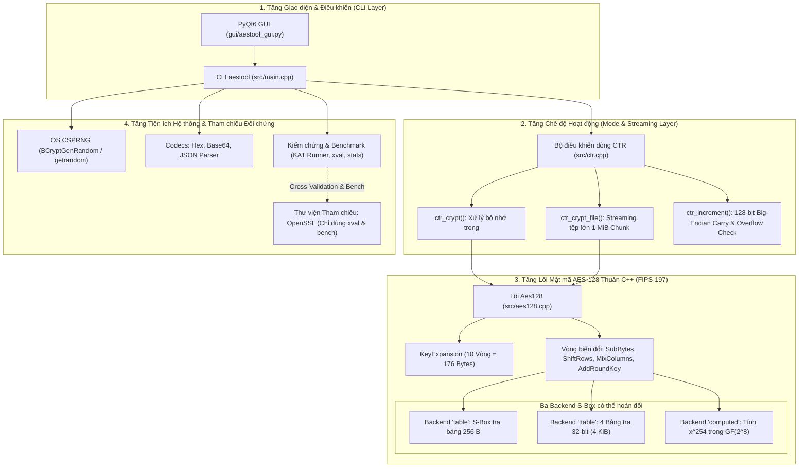

## 2.2. Cấu trúc thư mục và Hệ thống Build CMake Out-of-Source
Dự án được tổ chức khoa học, tách bạch giữa mã nguồn, kiểm thử, bộ vector mẫu, kịch bản tự động hóa và kết quả thực nghiệm:

```text
lab2/
├── CMakeLists.txt              # Cấu hình biên dịch CMake đa nền tảng
├── README.md                   # Tài liệu hướng dẫn sử dụng và đặc tả kỹ thuật
├── require.md                  # Bản dịch chi tiết yêu cầu đề bài và rubric chấm điểm
├── kat/
│   └── vectors.json            # 21 vector kiểm thử chuẩn FIPS-197, AESAVS và SP 800-38A
├── src/
│   ├── aes128.hpp / .cpp       # Lõi AES-128, lịch khóa và 3 backend S-Box
│   ├── aes_tables.hpp          # Bảng tra S-Box, InvS-Box, Rcon và T-Tables
│   ├── ctr.hpp / .cpp          # Chế độ dòng CTR, quản lý counter và streaming I/O
│   ├── bench.hpp / .cpp        # Đo lường hiệu năng thực nghiệm chuẩn khoa học
│   ├── stats.hpp / .cpp        # Xử lý thống kê: Mean, Median, StdDev, CI 95%
│   ├── kat.hpp / .cpp          # Trình chạy kiểm thử Known Answer Tests tự động
│   ├── xval.hpp / .cpp         # Kiểm chứng chéo độc lập với OpenSSL
│   ├── json.hpp / .cpp         # Trình phân tích cú pháp JSON nội bộ (không dùng thư viện ngoài)
│   ├── util.hpp / .cpp         # OS CSPRNG, bộ mã hóa Hex/Base64, I/O an toàn
│   ├── errors.hpp              # Hệ thống mã lỗi và xử lý ngoại lệ fail-closed
│   └── main.cpp                # Điểm vào chương trình dòng lệnh CLI aestool
├── tests/
│   ├── test_aes.cpp            # Bộ kiểm thử đơn vị Catch2 (23 test cases, 1063 assertions)
│   └── cli_e2e.cmake           # Kịch bản kiểm thử tích hợp CLI đầu cuối
├── scripts/
│   ├── build_linux.sh          # Tự động cấu hình, build và test trên Linux (GCC/Clang)
│   ├── build_windows.bat       # Tự động cấu hình, build và test trên Windows (MSVC/MinGW)
│   ├── build.sh / build.bat    # Script bao bọc quy trình build chuẩn
│   ├── bench.sh / bench.bat    # Thực thi đo benchmark tự động theo kịch bản chuẩn
│   ├── demo.sh                 # Kịch bản demo round-trip và negative tests
│   ├── plot_bench.py           # Vẽ đồ thị throughput và latency có error bar
│   └── compare.py              # So sánh đối đầu đa nền tảng Windows vs Linux
├── gui/
│   └── aestool_gui.py          # Giao diện đồ họa PyQt6 chuyên nghiệp
├── release/                    # Thư mục chứa các tệp thực thi binary đóng gói sẵn
│   ├── ubuntu/aestool_gcc      # Binary Linux 64-bit biên dịch bằng GCC
│   └── windows/aestool_msvc.exe# Binary Windows 64-bit biên dịch bằng MSVC
└── Output/                     # Toàn bộ nhật ký kiểm thử, kết quả đo CSV và biểu đồ PNG
    ├── compare/                # Bảng CSV so sánh và đồ thị đối đầu Windows vs Linux
    ├── ubuntu/                 # Logs kiểm thử KAT, xval, negative tests và benchmark Ubuntu
    └── windows/                # Logs kiểm thử KAT, xval, negative tests và benchmark Windows
```

Hệ thống xây dựng được cấu hình qua [CMakeLists.txt](file:///d:/UIT/NT219/crypto-labs/lab2/CMakeLists.txt), bảo đảm các tiêu chuẩn công nghiệp:
- Bắt buộc C++17 (`set(CMAKE_CXX_STANDARD 17)`, `set(CMAKE_CXX_STANDARD_REQUIRED ON)`).
- Kích hoạt toàn bộ cảnh báo biên dịch nghiêm ngặt: `/W4` trên MSVC, `-Wall -Wextra -Wpedantic` trên GCC/Clang; cờ `-Werror` được bật mặc định trên GCC/Clang nhằm ngăn ngừa triệt để các lỗi tiềm ẩn.
- Quản lý phụ thuộc Catch2 v3 hiện đại: Tự động tìm kiếm Catch2 trên hệ thống cục bộ; nếu chưa có, CMake kích hoạt cơ chế `FetchContent` để tự động tải và biên dịch Catch2 v3.5.3 độc lập.
- Out-of-source build tuyệt đối: Ngăn ngừa việc sinh rác vào thư mục nguồn bằng cách yêu cầu tạo thư mục xây dựng riêng biệt (`build_windows_msvc`, `build_windows_gcc`, `build_ubuntu_gcc`).

## 2.3. Chi tiết cài đặt Lõi AES-128 thuần C++ (FIPS-197)

### 2.3.1. Cấu trúc State Matrix và Mô hình dữ liệu
Theo chuẩn NIST FIPS-197 §3.4, dữ liệu đầu vào 128 bit (16 bytes) được nạp vào ma trận trạng thái (*State Matrix*) kích thước $4 \times 4$ byte theo thứ tự **ưu tiên cột (*column-major order*)**:

$$\text{State} = \begin{bmatrix} s_{0,0} & s_{0,1} & s_{0,2} & s_{0,3} \\ s_{1,0} & s_{1,1} & s_{1,2} & s_{1,3} \\ s_{2,0} & s_{2,1} & s_{2,2} & s_{2,3} \\ s_{3,0} & s_{3,1} & s_{3,2} & s_{3,3} \end{bmatrix} \iff \text{Mảng 1D: } s[4c + r] = s_{r,c}$$

Trong [src/aes128.cpp](file:///d:/UIT/NT219/crypto-labs/lab2/src/aes128.cpp), mảng một chiều 16 phần tử `uint8_t s[16]` được ánh xạ chính xác theo quy ước này. Phép cộng khóa vòng `AddRoundKey` được cài đặt bằng phép toán XOR trực tiếp giữa ma trận trạng thái và 16 byte khóa của vòng tương ứng:

```cpp
inline void add_round_key(uint8_t* s, const uint8_t* rk) {
  for (int i = 0; i < 16; ++i) s[i] ^= rk[i];
}
```

### 2.3.2. Ba Backend S-Box: Đánh đổi Hiệu năng - Bộ nhớ - An toàn
Để phục vụ việc phân tích chuyên sâu mối quan hệ đánh đổi giữa hiệu năng, bộ nhớ và an toàn kênh kề theo yêu cầu của đề bài, mã nguồn cung cấp 3 backend S-Box độc lập:

1. **Backend `table` (SBoxTable - Mặc định theo FIPS-197):**
   Sử dụng bảng tra 256 phần tử được tính toán sẵn theo chuẩn FIPS-197 Figure 7. Mỗi byte trạng thái $x$ được thay thế trực tiếp bằng $S(x) = \text{SBOX}[x]$.
   - *Ưu điểm:* Cực kỳ đơn giản, trực quan, tốc độ xử lý nhanh và ổn định (~45 - 62 MB/s).
   - *Nhược điểm:* Chỉ số truy cập bảng tra phụ thuộc trực tiếp vào dữ liệu bí mật ($x = p_i \oplus k_i$), tạo ra lỗ hổng rò rỉ thời gian bộ nhớ đệm (*cache-timing leakage*).
   - *Dung lượng:* Bảng thuận 256 B + Bảng nghịch đảo 256 B = 512 Bytes.

2. **Backend `ttable` (T-Table tối ưu hóa 32-bit):**
   Gộp ba phép biến đổi `SubBytes`, `ShiftRows` và `MixColumns` của một vòng thành các phép tra bảng trên 4 bảng tra kích thước $256 \times 4$ byte ($T_0, T_1, T_2, T_3$), mỗi bảng chiếm 1 KiB (tổng cộng 4 KiB):
   
   $$T_0[x] = \begin{bmatrix} \{02\} \cdot S(x) \\ S(x) \\ S(x) \\ \{03\} \cdot S(x) \end{bmatrix}, \quad T_1[x] = \text{RotByte}(T_0[x]), \quad \dots$$

   Một cột của trạng thái vòng kế tiếp được tính toán gọn gàng bằng 4 phép tra bảng và 4 phép XOR 32-bit:
   
   $$\text{Col}_j' = T_0[s_{0,j}] \oplus T_1[s_{1,j+1}] \oplus T_2[s_{2,j+2}] \oplus T_3[s_{3,j+3}] \oplus \text{RoundKey}_j$$

   - *Ưu điểm:* Tốc độ vượt trội, xử lý trên từ 32-bit của CPU, đạt thông lượng lên tới 180 - 275 MB/s (nhanh gấp ~4.5x - 5x so với `table`).
   - *Nhược điểm:* Dung lượng 4 KiB chiếm trọn nhiều đường cache L1D, là đối tượng kinh điển của các cuộc tấn công thám mã cache-timing (Bernstein 2005).

3. **Backend `computed` (S-Box Tính toán Đại số Constant-Time không bảng tra):**
   Triển khai trực tiếp định nghĩa toán học của S-Box theo FIPS-197 §5.1.1 mà **hoàn toàn không dùng bất kỳ bảng tra nào trong bộ nhớ**:
   
   $$S(x) = \text{AffineTransformation}(x^{-1} \pmod{m(x)})$$

   Trong đó, phần tử nghịch đảo nhân trên trường hữu hạn $GF(2^8)$ được tính thông qua định lý Fermat nhỏ: $x^{-1} = x^{254} = x^{2 + 4 + 8 + 16 + 32 + 64 + 128}$. Phép nhân trên trường $GF(2^8)$ được cài đặt hoàn toàn **không rẽ nhánh (*branch-free*)**:
   
   ```cpp
   inline uint8_t gmul_ct(uint8_t a, uint8_t b) {
     uint8_t p = 0;
     for (int i = 0; i < 8; ++i) {
       p ^= static_cast<uint8_t>(a & static_cast<uint8_t>(0 - (b & 1)));
       const uint8_t hi = static_cast<uint8_t>(a >> 7);
       a = static_cast<uint8_t>((a << 1) ^ (0x1B & static_cast<uint8_t>(0 - hi)));
       b = static_cast<uint8_t>(b >> 1);
     }
     return p;
   }
   ```
   
   Phép nghịch đảo nhân `gf_inv_ct(x)` thực hiện 7 phép bình phương liên tiếp và 7 phép nhân. Phép biến đổi Affine được tính toán bằng các phép dịch bit xoay vòng `rotl8`:
   
   $$b_i' = b_i \oplus b_{(i+4)\bmod 8} \oplus b_{(i+5)\bmod 8} \oplus b_{(i+6)\bmod 8} \oplus b_{(i+7)\bmod 8} \oplus c_i$$
   
   - *Ưu điểm:* Dung lượng bộ nhớ S-Box bằng 0 Byte. Triệt tiêu hoàn toàn mẫu truy cập bộ nhớ phụ thuộc vào bí mật, loại bỏ rủi ro rò rỉ cache line.
   - *Nhược điểm:* Chi phí tính toán CPU cực lớn. Tốc độ sụt giảm xuống còn khoảng ~1 MB/s (chậm hơn ~50x - 100x so với `table`).

### 2.3.3. Phép biến đổi ShiftRows và InvShiftRows
Phép biến đổi `ShiftRows` dịch vòng trái các byte trên từng hàng của State Matrix: hàng 0 không dịch, hàng 1 dịch 1 byte, hàng 2 dịch 2 byte, hàng 3 dịch 3 byte. Trong [src/aes128.cpp](file:///d:/UIT/NT219/crypto-labs/lab2/src/aes128.cpp), việc dịch hàng được tối ưu hóa không nhánh:

```cpp
inline void shift_rows(uint8_t* s) {
  uint8_t t[16];
  for (int c = 0; c < 4; ++c)
    for (int r = 0; r < 4; ++r) t[4 * c + r] = s[4 * ((c + r) & 3) + r];
  std::memcpy(s, t, 16);
}
```

Ngược lại, `inv_shift_rows` dịch vòng phải các byte tương ứng để phục vụ quá trình giải mã khối.

### 2.3.4. Phép biến đổi MixColumns và InvMixColumns trên trường $GF(2^8)$
Phép biến đổi `MixColumns` xem mỗi cột của State Matrix như một đa thức bậc 3 trên trường $GF(2^8)$ và nhân nó với đa thức cố định $c(x) = \{03\}x^3 + \{01\}x^2 + \{01\}x + \{02\} \pmod{x^4 + 1}$. Phép toán tương đương với phép nhân ma trận:

$$\begin{bmatrix} s_{0,c}' \\ s_{1,c}' \\ s_{2,c}' \\ s_{3,c}' \end{bmatrix} = \begin{bmatrix} 02 & 03 & 01 & 01 \\ 01 & 02 & 03 & 01 \\ 01 & 01 & 02 & 03 \\ 03 & 01 & 01 & 02 \end{bmatrix} \begin{bmatrix} s_{0,c} \\ s_{1,c} \\ s_{2,c} \\ s_{3,c} \end{bmatrix}$$

Hàm nhân với $\{02\}$ (gọi là `xt(x)` hay $xtime$) được cài đặt không rẽ nhánh: `(x << 1) ^ (0x1B * (x >> 7))`. Bằng cách đặt $t = a_0 \oplus a_1 \oplus a_2 \oplus a_3$, phép nhân cột được rút gọn đáng kể số lượng phép toán:

```cpp
inline void mix_columns(uint8_t* s) {
  for (int c = 0; c < 4; ++c) {
    uint8_t* col = s + 4 * c;
    const uint8_t a0 = col[0], a1 = col[1], a2 = col[2], a3 = col[3];
    const uint8_t t = static_cast<uint8_t>(a0 ^ a1 ^ a2 ^ a3);
    col[0] = static_cast<uint8_t>(a0 ^ t ^ xt(static_cast<uint8_t>(a0 ^ a1)));
    col[1] = static_cast<uint8_t>(a1 ^ t ^ xt(static_cast<uint8_t>(a1 ^ a2)));
    col[2] = static_cast<uint8_t>(a2 ^ t ^ xt(static_cast<uint8_t>(a2 ^ a3)));
    col[3] = static_cast<uint8_t>(a3 ^ t ^ xt(static_cast<uint8_t>(a3 ^ a0)));
  }
}
```

Đối với phép giải mã nghịch đảo `inv_mix_columns`, ma trận nhân chứa các hệ số $\{0e\}, \{0b\}, \{0d\}, \{09\}$, được cài đặt thông qua các hàm nhân trung gian `m14`, `m11`, `m13`, `m9` dựa trên phép gọi lặp `xt()`.

### 2.3.5. Thuật toán Lịch sinh khóa (KeyExpansion)
Theo FIPS-197 §5.2, khóa gốc 16 byte (4 từ 32-bit $w_0, w_1, w_2, w_3$) được mở rộng thành 44 từ 32-bit ($w_0, \dots, w_{43}$), tương đương 11 khóa vòng (176 bytes).
- Mỗi từ $w_i$ ($i \ge 4$) được tính bằng: $w_i = w_{i-4} \oplus \text{Temp}$.
- Khi $i \equiv 0 \pmod 4$: $\text{Temp} = \text{SubWord}(\text{RotWord}(w_{i-1})) \oplus \text{Rcon}[i/4 - 1]$.
- Hằng số vòng $\text{Rcon}[j]$ là từ 32-bit dạng $[RC[j], 0x00, 0x00, 0x00]$ với $RC[1] = 0x01, RC[j] = xt(RC[j-1])$.

Lớp `Aes128` bảo đảm an toàn bộ nhớ tuyệt đối thông qua cơ chế RAII: destructor `~Aes128()` luôn tự động gọi `secure_zero` để xóa sạch toàn bộ 176 byte khóa vòng `rk_` và 44 từ khóa `rkw_` ngay khi đối tượng kết thúc vòng đời.

---
## 2.4. Chi tiết cài đặt Chế độ CTR (NIST SP 800-38A)

### 2.4.1. Đặc tả Khối Counter và Quy tắc Big-Endian
Theo tiêu chuẩn NIST SP 800-38A §6.5 và Phụ lục B.1, chế độ Counter (CTR) biến đổi thuật toán mã hóa khối AES thành một hệ mật mã dòng (*stream cipher*). 
- Khối đầu vào của hàm mã hóa khối được gọi là **khối đếm (*Counter Block*)** kích thước 128 bit, ký hiệu là $T_i$ ($i = 1, 2, \dots$).
- Vector khởi tạo (IV) 16 byte (128 bit) do người dùng cung cấp hoặc do hệ thống tự sinh đóng vai trò chính là khối đếm khởi tạo $T_1$.
- **Quy tắc Endianness:** Cài đặt tuân thủ chặt chẽ định dạng **128-bit Big-Endian nguyên khối trên toàn bộ 16 byte của IV**:
  - Byte thứ 15 (`ctr[15]`) là byte có trọng số thấp nhất (*Least Significant Byte - LSB*) và được tăng đầu tiên.
  - Byte thứ 0 (`ctr[0]`) là byte có trọng số cao nhất (*Most Significant Byte - MSB*).
  - Khi một byte đạt giá trị cực đại `0xFF` và được cộng thêm 1, nó quay về `0x00` và biến nhớ nhớ (*carry*) được lan truyền liên tục sang byte đứng trước nó (từ byte 15 ngược dần về byte 0).

Hàm tăng bộ đếm [ctr_increment](file:///d:/UIT/NT219/crypto-labs/lab2/src/ctr.cpp#L15-L20) được hiện thực ngắn gọn và chuẩn xác:

```cpp
bool ctr_increment(uint8_t ctr[16]) {
  for (int i = 15; i >= 0; --i) {
    if (++ctr[i] != 0) return false;  // Không có carry tràn khỏi byte này -> hoàn tất
  }
  return true;  // Toàn bộ 16 byte đều là 0xFF -> bộ đếm bị tràn (wrap-around)
}
```

### 2.4.2. Cơ chế sinh Keystream và Mã hóa/Giải mã Không Padding
Với khóa bí mật $K$, chuỗi khối đếm $T_1, T_2, \dots$ được mã hóa qua hàm mã hóa khối thuận của AES để sinh ra dòng khóa (*keystream blocks*) $S_i$:

$$S_i = \text{AES-Encrypt}_K(T_i), \quad i = 1, 2, \dots$$

Dữ liệu bản rõ (*Plaintext*) $P$ được chia thành các khối $P_1, P_2, \dots$ tương ứng. Bản mã (*Ciphertext*) $C_i$ được tạo ra bằng phép toán XOR trực tiếp:

$$C_i = P_i \oplus S_i$$

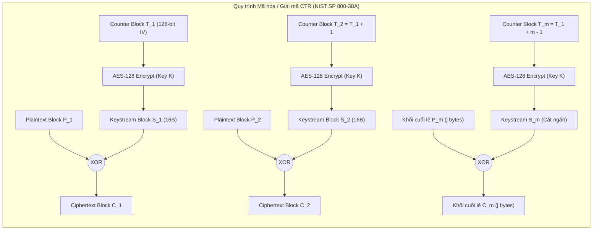

**Các đặc điểm then chốt của cài đặt:**
1. **Không sử dụng đệm (No Padding):** Vì là mã dòng, chế độ CTR hỗ trợ xử lý dữ liệu có độ dài tùy ý. Nếu khối cuối cùng $P_m$ chỉ có độ dài $j$ byte ($1 \le j < 16$), hệ thống chỉ sử dụng đúng $j$ byte đầu tiên của khối dòng khóa $S_m$ để XOR: $C_m = P_m \oplus \text{Truncate}_j(S_m)$. Kích thước bản mã luôn luôn bằng chính xác kích thước bản rõ:
   
   $$\text{len}(\text{Ciphertext}) = \text{len}(\text{Plaintext})$$

2. **Tính đối xứng hoàn hảo giữa Mã hóa và Giải mã:** Do tính chất phản xạ của phép toán XOR ($A \oplus B \oplus B = A$), quá trình giải mã sử dụng **chính xác cùng một thuật toán và cùng một dòng khóa $S_i$**:
   
   $$P_i = C_i \oplus S_i = (P_i \oplus S_i) \oplus S_i = P_i$$

   Do đó, trong cả hai chiều `encrypt` và `decrypt`, chương trình luôn luôn gọi hàm mã hóa thuận `Aes128::encrypt_block` để sinh keystream. Hàm giải mã nghịch đảo `Aes128::decrypt_block` hoàn toàn không cần dùng đến trong chế độ CTR.

### 2.4.3. Kiến trúc Streaming File I/O Xử lý Tệp Đa-GiB
Để xử lý mượt mà các tệp tin có dung lượng khổng lồ (từ 100 MiB đến hàng chục GiB) mà không gây tràn bộ nhớ RAM của hệ thống, lớp [CtrStream](file:///d:/UIT/NT219/crypto-labs/lab2/src/ctr.hpp#L28-L48) và hàm [ctr_crypt_file](file:///d:/UIT/NT219/crypto-labs/lab2/src/ctr.cpp#L61-L109) được thiết kế theo mô hình xử lý dòng (*streaming pipeline*):
- Cấp phát bộ đệm luân chuyển cố định kích thước 1 MiB (`Bytes buf(1 << 20)`).
- Đọc từng khối 1 MiB từ tệp đầu vào, đẩy qua bộ xử lý `stream.process()`, và ghi trực tiếp ra tệp tạm `<output>.tmp`.
- Vị trí byte dở dang của dòng khóa được lưu trữ trong con trỏ nội bộ `pos_` và duy trì liên tục qua các lần gọi, bảo đảm tính nhất quán dữ liệu xuyên suốt giữa các khối 1 MiB.
- Khi quá trình mã hóa hoàn tất thành công 100%, hệ thống thực hiện thao tác đổi tên nguyên tử (*atomic rename*) từ `<output>.tmp` thành `<output>`. Nếu có bất kỳ lỗi nào xảy ra trong quá trình truyền dữ liệu (lỗi đọc/ghi I/O, tràn counter), khối `catch (...)` sẽ lập tức đóng tệp và xóa sạch tệp tạm `.tmp` khỏi đĩa cứng (triệt để tuân thủ nguyên lý *Fail-Closed*).

---

## 2.5. Thiết kế Giao diện Dòng lệnh (CLI) và Quản trị Khóa/IV

### 2.5.1. Bảng tham số và Đặc tả mã thoát (Exit Codes)
Chương trình dòng lệnh `aestool` được thiết kế đồng bộ theo chuẩn POSIX với đầy đủ tham số điều khiển:

| Nhóm chức năng | Lệnh / Tham số | Kiểu dữ liệu | Ý nghĩa và Quy tắc kiểm tra |
| :--- | :--- | :---: | :--- |
| **Lệnh chính** | `encrypt` | Lệnh | Thực hiện biến đổi mã hóa CTR |
| | `decrypt` | Lệnh | Thực hiện biến đổi giải mã CTR |
| | `keygen` | Lệnh | Sinh khóa AES-128 ngẫu nhiên 16 byte bằng OS CSPRNG |
| | `ivgen` | Lệnh | Sinh IV chuẩn: 12 byte nonce ngẫu nhiên + 4 byte counter zero |
| | `--kat FILE` | Lệnh / Cờ | Chạy bộ kiểm thử Known Answer Tests từ tệp JSON |
| | `xval` | Lệnh | Kiểm chứng chéo kết quả với OpenSSL (`--cases N`) |
| | `bench` | Lệnh | Đo lường hiệu năng (`--sizes`, `--runs`, `--backends`) |
| **Khóa & IV** | `--key FILE` | Tệp | Đường dẫn tệp khóa nhị phân, bắt buộc đúng 16 byte |
| | `--key-hex HEX` | Chuỗi | Chuỗi khóa dạng Hex, bắt buộc đúng 32 ký tự hex |
| | `--iv FILE` | Tệp | Đường dẫn tệp IV nhị phân, bắt buộc đúng 16 byte |
| | `--iv-hex HEX` | Chuỗi | Chuỗi IV dạng Hex, bắt buộc đúng 32 ký tự hex |
| **Dữ liệu I/O** | `--in FILE` | Tệp | Đường dẫn tệp dữ liệu đầu vào |
| | `--text STRING` | Chuỗi | Chuỗi văn bản đầu vào (UTF-8) |
| | `--out FILE` | Tệp | Đường dẫn tệp dữ liệu đầu ra |
| | `--in-encode ENC` | raw/hex/base64| Định dạng giải mã dữ liệu đầu vào (mặc định: raw) |
| | `--encode ENC` | raw/hex/base64| Định dạng mã hóa đầu ra (màn hình: hex; tệp: raw) |
| **Điều khiển** | `--mode ctr` | Chuỗi | Chế độ hoạt động (chỉ hỗ trợ `ctr`) |
| | `--sbox BACKEND`| table/ttable/computed | Chọn backend S-Box của AES (mặc định: table) |
| | `--force` | Cờ | Cho phép ghi đè tệp đầu ra nếu đã tồn tại |
| | `--quiet` / `--verbose` | Cờ | Tắt bớt thông báo chẩn đoán / In chi tiết debug |

**Đặc tả hệ thống mã thoát chuẩn (Exit Codes):**
Nhằm phục vụ tích hợp kiểm thử tự động và ngăn ngừa rò rỉ thông tin, mọi kết quả thực thi của `aestool` đều được phân loại qua bảng mã thoát nghiêm ngặt trong [src/errors.hpp](file:///d:/UIT/NT219/crypto-labs/lab2/src/errors.hpp):

| Mã thoát | Tên định danh (Enum) | Ý nghĩa nghiệp vụ | Hành vi bảo mật |
| :---: | :--- | :--- | :--- |
| **`0`** | `ExitCode::Ok` | Thực thi thành công hoàn toàn | Dữ liệu đầu ra hợp lệ |
| **`1`** | `ExitCode::Failure` | Lỗi nội bộ không xác định | Thông báo ngắn gọn, không rò rỉ bộ nhớ |
| **`2`** | `ExitCode::Usage` | Sai cú pháp dòng lệnh, mode không hỗ trợ | In hướng dẫn sử dụng tóm tắt |
| **`3`** | `ExitCode::InvalidInput` | Khóa/IV sai độ dài, Hex/Base64/JSON hỏng | Từ chối ngay lập tức, không xử lý tiếp |
| **`4`** | `ExitCode::Io` | Tệp không tồn tại, lỗi I/O, tệp đã có sẵn | Chặn ghi đè tệp cũ khi chưa có `--force` |
| **`5`** | `ExitCode::CounterOverflow`| Bộ đếm CTR bị tràn (vượt quá `FF..FF`) | Chặn đứng rủi ro Two-Time Pad, xóa tệp tạm |
| **`6`** | `ExitCode::KatFailed` | Vector KAT hoặc cross-validation thất bại | Cảnh báo sai lệch chuẩn toán học |

### 2.5.2. Quản lý Vector Khởi tạo (IV) và Cơ chế Sidecar Tự động
Để loại bỏ hoàn toàn khả năng người dùng vô tình tái sử dụng IV cố định (vốn là nguyên nhân dẫn đến thảm họa phá vỡ bí mật của mã dòng CTR), `aestool` áp dụng nguyên tắc **Bảo mật theo Thiết kế (Secure by Design)**:
1. **Tự động sinh IV ngẫu nhiên an toàn:** Khi thực hiện lệnh `encrypt` mà người dùng không truyền tham số `--iv` hoặc `--iv-hex`, chương trình sẽ tự động kích hoạt hàm [make_iv_default()](file:///d:/UIT/NT219/crypto-labs/lab2/src/main.cpp#L177-L181):
   - 12 byte đầu tiên (96 bit) được sinh ngẫu nhiên từ CSPRNG của hệ điều hành đóng vai trò là **Nonce**.
   - 4 byte cuối cùng (32 bit) được khởi tạo bằng `0x00000000` đóng vai trò là **Counter bắt đầu**.
   - Cấu trúc này cho phép mã hóa an toàn tới $2^{32}$ khối 16 byte ($\approx 68.7 \text{ GiB}$) cho mỗi thông điệp mà không sợ trùng lặp counter.
2. **Cơ chế lưu trữ và nạp Sidecar (`.iv`):**
   - Khi mã hóa tệp ra `--out file.bin`, chương trình tự động ghi 16 byte IV nhị phân thô vào tệp phụ trợ đi kèm: `file.bin.iv`.
   - Trước khi thực hiện mã hóa, hệ thống kiểm tra trước (*pre-flight check*): nếu tệp `file.bin.iv` đã tồn tại trên đĩa, chương trình từ chối ghi đè ngay lập tức (trừ khi có `--force`), ngăn chặn triệt để trạng thái mất đồng bộ giữa bản mã và IV.
   - Khi giải mã (`decrypt --in file.bin`), nếu người dùng không truyền `--iv`, chương trình sẽ tự động tìm kiếm và nạp tệp `file.bin.iv`.
3. **Cảnh báo an toàn khi nhập IV thủ công:** Nếu người dùng chủ động truyền `--iv` hoặc `--iv-hex`, chương trình sẽ phát cảnh báo bảo mật ra màn hình để cảnh báo rủi ro tái sử dụng:
   ```text
   WARNING: IV supplied manually. Reusing a (key, IV) pair destroys confidentiality (two-time pad).
   ```

### 2.5.3. Xử lý An toàn Mã ký tự Unicode UTF-8 trên Đa Nền tảng
Trên hệ điều hành Windows, các đối số dòng lệnh nhận qua `main(int argc, char** argv)` mặc định bị ép theo trang mã ANSI truyền thống của hệ thống (ví dụ CP1252), gây hỏng các chuỗi văn bản Unicode tiếng Việt (như "xin chào", "bí mật").

Để giải quyết triệt để vấn đề này, chương trình cài đặt hàm [get_args](file:///d:/UIT/NT219/crypto-labs/lab2/src/main.cpp#L79-L99) chuyên biệt cho Windows:
- Gọi hàm API hệ thống `GetCommandLineW()` và `CommandLineToArgvW()` để lấy mảng đối số dưới dạng UTF-16 nguyên bản của Windows.
- Chuyển đổi tường minh sang chuỗi UTF-8 chuẩn thông qua hàm `WideCharToMultiByte(CP_UTF8, ...)`.
- Nhờ cơ chế này, `aestool` xử lý trơn tru chuỗi văn bản tiếng Việt UTF-8 có dấu trên cả Command Prompt của Windows lẫn Bash Shell của Linux mà không phát sinh lỗi mã hóa ký tự.

---

# 3. Thiết kế An toàn và Cơ chế Chống Dùng Sai (Misuse Resistance)

## 3.1. Mô hình Đe dọa (Threat Model) và Kịch bản Rủi ro
Trong quá trình thiết kế `aestool`, hệ thống được đặt trong mô hình đe dọa thực tế với 4 nhóm tác nhân tấn công:
1. **Kẻ nghe lén thụ động (Passive Eavesdropper):** Có khả năng thu thập toàn bộ các tệp bản mã $C_1, C_2$ và các tệp sidecar IV truyền qua kênh mạng công cộng hoặc lưu trữ trên ổ đĩa. Mục tiêu của kẻ tấn công là khôi phục nội dung bản rõ $P$ hoặc tìm ra khóa bí mật $K$.
2. **Kẻ tấn công chủ động can thiệp (Active Attacker / Tampering):** Có khả năng chỉnh sửa, chèn thêm, xóa bớt hoặc đảo các bit trên đường truyền của tệp bản mã $C$. Mục tiêu là làm sai lệch nội dung bản rõ sau khi giải mã mà không bị người nhận phát hiện.
3. **Kẻ tấn công kênh kề cục bộ (Local Side-Channel / Cache-Timing Attacker):** Là một tiến trình độc hại chạy cùng máy chủ ảo (co-located VM) hoặc chia sẻ chung CPU/bộ nhớ đệm L1/L2 với tiến trình mật mã. Mục tiêu là đo lường thời gian thực thi hoặc trạng thái bộ nhớ đệm để khôi phục khóa bí mật của AES.
4. **Người dùng vô ý hoặc phần mềm tích hợp sai (Accidental Misuse):** Sử dụng lặp lại một IV cố định cho nhiều tệp dữ liệu khác nhau, cung cấp khóa/IV sai độ dài, hoặc mã hóa dữ liệu vượt quá giới hạn dung lượng của bộ đếm 128 bit.

## 3.2. Quy tắc Bất biến: Tính Duy nhất của Cặp (Key, IV)
Nguyên tắc sống còn trong mật mã học dòng đối với chế độ CTR là: **Một cặp $(Key, IV)$ tuyệt đối không bao giờ được phép sử dụng lại cho nhiều hơn một thông điệp.**

Nếu cùng một cặp khóa $K$ và vector khởi tạo $IV$ được sử dụng để mã hóa hai bản rõ khác nhau $P_1$ và $P_2$, dòng khóa sinh ra $S = \text{AES}_K(IV)$ sẽ hoàn toàn trùng nhau:

$$C_1 = P_1 \oplus S, \quad C_2 = P_2 \oplus S$$

Kẻ nghe lén thụ động chỉ cần thực hiện phép XOR giữa hai bản mã thu thập được:

$$C_1 \oplus C_2 = (P_1 \oplus S) \oplus (P_2 \oplus S) = P_1 \oplus P_2$$

Khi dòng khóa $S$ đã bị triệt tiêu, việc khôi phục lại nội dung gốc của $P_1$ và $P_2$ trở nên vô cùng dễ dàng thông qua các kỹ thuật thám mã kinh điển của bài toán **Two-Time Pad**:
- Dựa trên đặc trưng thống kê tần suất ký tự của ngôn ngữ tự nhiên (khoảng trắng XOR với ký tự chữ cái sẽ làm đảo ngược bit hoa/thường).
- Tấn công bằng bản rõ biết trước (*Known-Plaintext Attack*): Nếu kẻ tấn công biết một phần định dạng cố định của $P_1$ (ví dụ header của tệp PDF `%PDF-`, header JSON `{"status":`), họ có thể tính ngay được $P_2 = (C_1 \oplus C_2) \oplus P_1$.

Chính vì tính chất hủy diệt này, `aestool` áp dụng chính sách tự động sinh nonce ngẫu nhiên 96-bit từ CSPRNG và luôn phát cảnh báo khi người dùng tự ý cung cấp IV thủ công.

## 3.3. Cơ chế Chặn Tràn Bộ đếm Counter (Counter Overflow Prevention)
Một trong những lỗi triển khai nguy hiểm nhất của chế độ CTR trong thực tế là việc để **bộ đếm tự động quay vòng (*wrap-around*)** khi đạt đến giá trị cực đại. 
- Giả sử một người dùng cố tình hoặc vô ý chọn IV có giá trị kết thúc bằng `FF FF ... FF`.
- Nếu bộ đếm tự động quay vòng về `00 00 ... 00` mà không bị ngăn chặn, các khối dữ liệu tiếp theo sẽ được mã hóa bằng chính các khối dòng khóa đã được sử dụng trước đó, gây ra thảm họa tái sử dụng keystream ngay trong cùng một tệp tin!

**Giải pháp triệt để của `aestool`:**
Theo đúng quy định chuẩn của NIST SP 800-38A, chương trình **tuyệt đối không cho phép bộ đếm quay vòng**. Cơ chế phát hiện tràn được tích hợp ngay trong hàm [refill()](file:///d:/UIT/NT219/crypto-labs/lab2/src/ctr.cpp#L33-L40):
1. Trước khi tạo keystream mới, hệ thống kiểm tra cờ `exhausted_`.
2. Sau khi mã hóa khối đếm hiện tại, hàm `ctr_increment(ctr_)` được gọi. Nếu carry tràn khỏi byte 0 (toàn bộ 128 bit đều là 1), cờ `exhausted_ = true` được đánh dấu.
3. Nếu tệp tin vẫn còn dữ liệu và yêu cầu thêm một khối keystream nữa, chương trình lập tức ném ngoại lệ:
   ```cpp
   throw Error(ExitCode::CounterOverflow,
               "CTR counter overflow: message too long for this IV (keystream would repeat)");
   ```
4. Quá trình dừng ngay lập tức với mã thoát `5` (`ExitCode::CounterOverflow`), tệp tạm `.tmp` bị xóa sạch khỏi hệ thống, bảo vệ an toàn dữ liệu tuyệt đối.

## 3.4. Cơ chế Bảo vệ Chống Ghi đè Tệp (Overwrite Protection)
Để ngăn ngừa rủi ro người dùng vô tình làm mất dữ liệu quan trọng hoặc làm hỏng cặp khóa/IV đã lưu, `aestool` tích hợp cơ chế bảo vệ ghi đè hai lớp:
- Khi chỉ định tệp đầu ra `--out <file>`, nếu `<file>` đã tồn tại trên đĩa, chương trình sẽ từ chối thực thi với mã lỗi `4` (`ExitCode::Io`):
  ```text
  error: output file 'out.bin' already exists (use --force to overwrite)
  ```
- Thậm chí trong trường hợp mã hóa tự sinh IV, hệ thống kiểm tra trước tệp sidecar `<file>.iv`. Nếu tệp `.iv` đã tồn tại, chương trình cũng từ chối thực thi ngay từ đầu để tránh tình huống bản mã mới bị ghi đè nhưng tệp IV cũ bị giữ lại (hoặc ngược lại), gây mất đồng bộ dữ liệu.
- Người dùng bắt buộc phải truyền cờ tường minh `--force` nếu thực sự muốn ghi đè lên các tệp đã có sẵn.

## 3.5. Triết lý Thiết kế Thất bại An toàn (Fail-Closed Architecture)
Toàn bộ kiến trúc phần mềm tuân thủ nguyên lý **Thất bại An toàn (*Fail-Closed*)**:
1. **Dừng lại ngay lập tức khi phát hiện lỗi:** Chương trình không bao giờ cố gắng "đoán" hoặc tự động sửa chữa dữ liệu bị sai định dạng. Khi gặp khóa sai độ dài, IV sai độ dài, hoặc chuỗi hex không hợp lệ, chương trình lập tức dừng thực thi.
2. **Không để lại dấu vết dữ liệu dở dang:** Toàn bộ quá trình ghi tệp được thực hiện qua tệp tạm `.tmp`. Nếu chương trình bị ngắt giữa chừng do lỗi I/O hoặc tràn counter, tệp tạm bị hủy bỏ ngay lập tức, không để lại tệp bản rõ/bản mã rác trên đĩa.
3. **Xóa sạch dữ liệu nhạy cảm khỏi bộ nhớ (Memory Sanitization):** 
   - Khóa bí mật và các khóa vòng mở rộng được lưu trữ trong các cấu trúc RAII có destructor tự động gọi hàm `secure_zero()`.
   - Hàm `secure_zero()` ghi đè các byte bằng `0` thông qua con trỏ `volatile uint8_t*` để ngăn ngừa trình biên dịch tối ưu hóa bỏ qua thao tác xóa bộ nhớ (*dead-store elimination*).
4. **Thông điệp lỗi ngắn gọn, không rò rỉ thông tin:** Các thông báo lỗi chỉ mô tả nguyên nhân cú pháp hoặc trạng thái I/O, tuyệt đối không in ra giá trị khóa, byte đệm hay cấu trúc nội bộ của hệ thống.

---
# 4. Phương pháp và Kết quả Kiểm chứng (Verification & Testing)

## 4.1. Bộ Vector Kiểm thử Mẫu Chính thức (NIST Known Answer Tests - KAT)
Để chứng minh tính đúng đắn toán học tuyệt đối của thuật toán lõi AES-128 và chế độ dòng CTR, dự án xây dựng bộ vector kiểm thử toàn diện gồm 21 ca kiểm thử được lưu trữ trong tệp cấu trúc [kat/vectors.json](file:///d:/UIT/NT219/crypto-labs/lab2/kat/vectors.json).

Bộ vector được tổng hợp từ 4 nguồn tài liệu tiêu chuẩn chính thức của Viện Tiêu chuẩn và Công nghệ Quốc gia Hoa Kỳ (NIST) và các bài kiểm tra biên do OpenSSL tạo ra:
1. **NIST FIPS-197 (Appendix B & Appendix C.1):** Kiểm chứng quá trình mã hóa/giải mã khối đơn và lịch sinh khóa chuẩn của AES-128.
2. **NIST Cryptographic Algorithm Validation Program (AESAVS):** Các bộ vector kiểm thử chuyên sâu cho S-Box (`ECBGFSbox128`, `ECBKeySbox128`), biến đổi bản rõ (`ECBVarTxt128`) và biến đổi khóa (`ECBVarKey128`).
3. **NIST SP 800-38A (Section F.5.1):** Bộ vector chuẩn cho chế độ AES-128-CTR trên thông điệp 4 khối (64 bytes), kèm theo các bài kiểm tra tính chất tiền tố (*prefix property*) trên các độ dài khối cuối lẻ (1 byte, 15 bytes, 17 bytes, 37 bytes, 63 bytes) và thông điệp rỗng (0 byte).
4. **Bộ kiểm thử lan truyền Carry (Cross-generated with OpenSSL 3.x/4.x):** Kiểm tra cơ chế lan truyền biến nhớ của bộ đếm 128-bit big-endian qua các ranh giới 8-bit, 16-bit, 64-bit và 96-bit.
5. **Bộ kiểm thử từ chối tràn Counter (Fail-Closed Overflow):** Kiểm tra việc ném ngoại lệ khi IV có giá trị cận biên (`FF..FF`) nhằm bảo đảm chương trình không bao giờ quay vòng keystream.

### Bảng Tổng hợp 21 Ca Kiểm thử Known Answer Tests:

| STT | Nhóm kiểm thử | ID Vector | Nguồn tiêu chuẩn trích dẫn | Độ dài | Kết quả kiểm thử |
| :---: | :--- | :--- | :--- | :---: | :---: |
| 1 | `aes128_block` | `fips197-appendix-b` | NIST FIPS-197 Appendix B | 16 B | **PASS** (3 backends) |
| 2 | `aes128_block` | `fips197-appendix-c1` | NIST FIPS-197 Appendix C.1 | 16 B | **PASS** (3 backends) |
| 3 | `aes128_block` | `aesavs-gfsbox-0` | NIST AESAVS ECBGFSbox128 #0 | 16 B | **PASS** (3 backends) |
| 4 | `aes128_block` | `aesavs-gfsbox-1` | NIST AESAVS ECBGFSbox128 #1 | 16 B | **PASS** (3 backends) |
| 5 | `aes128_block` | `aesavs-keysbox-0` | NIST AESAVS ECBKeySbox128 #0 | 16 B | **PASS** (3 backends) |
| 6 | `aes128_block` | `aesavs-vartxt-0` | NIST AESAVS ECBVarTxt128 #0 | 16 B | **PASS** (3 backends) |
| 7 | `aes128_block` | `aesavs-varkey-0` | NIST AESAVS ECBVarKey128 #0 | 16 B | **PASS** (3 backends) |
| 8 | `aes128_ctr` | `sp800-38a-f51-4blocks`| NIST SP 800-38A F.5.1 (4 blocks) | 64 B | **PASS** (3 backends) |
| 9 | `aes128_ctr` | `sp800-38a-f51-prefix-1B`| NIST SP 800-38A F.5.1 (1 byte prefix) | 1 B | **PASS** (3 backends) |
| 10 | `aes128_ctr` | `sp800-38a-f51-prefix-15B`| NIST SP 800-38A F.5.1 (15 bytes prefix) | 15 B | **PASS** (3 backends) |
| 11 | `aes128_ctr` | `sp800-38a-f51-prefix-17B`| NIST SP 800-38A F.5.1 (17 bytes prefix) | 17 B | **PASS** (3 backends) |
| 12 | `aes128_ctr` | `sp800-38a-f51-prefix-37B`| NIST SP 800-38A F.5.1 (37 bytes prefix) | 37 B | **PASS** (3 backends) |
| 13 | `aes128_ctr` | `sp800-38a-f51-prefix-63B`| NIST SP 800-38A F.5.1 (63 bytes prefix) | 63 B | **PASS** (3 backends) |
| 14 | `aes128_ctr` | `empty-message` | Empty input $\to$ Empty output | 0 B | **PASS** (3 backends) |
| 15 | `aes128_ctr` | `carry-low-byte` | Carry ranh giới byte thấp (OpenSSL ref) | 70 B | **PASS** (3 backends) |
| 16 | `aes128_ctr` | `carry-16bit` | Carry ranh giới 16-bit (OpenSSL ref) | 100 B | **PASS** (3 backends) |
| 17 | `aes128_ctr` | `carry-64bit` | Carry ranh giới 64-bit (OpenSSL ref) | 400 B | **PASS** (3 backends) |
| 18 | `aes128_ctr` | `carry-96bit` | Carry ranh giới 96-bit (OpenSSL ref) | 77 B | **PASS** (3 backends) |
| 19 | `aes128_ctr_errors`| `iv-all-ff-two-blocks`| IV toàn FF, yêu cầu 2 khối (17B) | 17 B | **PASS** (Tràn bị chặn) |
| 20 | `aes128_ctr_errors`| `iv-ff..fe-three-blocks`| IV FF..FE, yêu cầu 3 khối (33B) | 33 B | **PASS** (Tràn bị chặn) |
| 21 | `aes128_ctr_errors`| `iv-all-ff-33-bytes` | IV toàn FF, yêu cầu 3 khối (33B) | 33 B | **PASS** (Tràn bị chặn) |

---

## 4.2. Cài đặt và Vận hành Trình Kiểm thử KAT Runner Độc lập
Chương trình tích hợp sẵn trình chạy kiểm thử KAT Runner độc lập qua tham số dòng lệnh `--kat <tệp_json>`. 
- Để tuân thủ tuyệt đối ràng buộc không phụ thuộc thư viện ngoài, tác giả đã tự cài đặt một parser JSON nội bộ tối giản, an toàn trong [src/json.cpp](file:///d:/UIT/NT219/crypto-labs/lab2/src/json.cpp).
- Trình runner tự động nạp các vector, thực thi kiểm tra trên cả 3 backend (`table`, `ttable`, `computed`), đối chiếu cả hai chiều mã hóa và giải mã, đồng thời kiểm tra tính tương thích khi dữ liệu được phân chia thành các đoạn nhỏ ngẫu nhiên (*chunked stream*).

### Nhật ký Kiểm thử KAT thực tế trên Hệ điều hành Windows:
Trích xuất từ tệp nhật ký thực tế [Output/windows/kat/result.txt](file:///d:/UIT/NT219/crypto-labs/lab2/Output/windows/kat/result.txt):

```text
PASS  aes128_block/fips197-appendix-b  [3 backends x (encrypt+decrypt)]
PASS  aes128_block/fips197-appendix-c1  [3 backends x (encrypt+decrypt)]
PASS  aes128_block/aesavs-gfsbox-0  [3 backends x (encrypt+decrypt)]
PASS  aes128_block/aesavs-gfsbox-1  [3 backends x (encrypt+decrypt)]
PASS  aes128_block/aesavs-keysbox-0  [3 backends x (encrypt+decrypt)]
PASS  aes128_block/aesavs-vartxt-0  [3 backends x (encrypt+decrypt)]
PASS  aes128_block/aesavs-varkey-0  [3 backends x (encrypt+decrypt)]
PASS  aes128_ctr/sp800-38a-f51-4blocks  [64 bytes, 3 backends, enc+dec+chunked]
PASS  aes128_ctr/sp800-38a-f51-prefix-1B  [1 bytes, 3 backends, enc+dec+chunked]
PASS  aes128_ctr/sp800-38a-f51-prefix-15B  [15 bytes, 3 backends, enc+dec+chunked]
PASS  aes128_ctr/sp800-38a-f51-prefix-17B  [17 bytes, 3 backends, enc+dec+chunked]
PASS  aes128_ctr/sp800-38a-f51-prefix-37B  [37 bytes, 3 backends, enc+dec+chunked]
PASS  aes128_ctr/sp800-38a-f51-prefix-63B  [63 bytes, 3 backends, enc+dec+chunked]
PASS  aes128_ctr/empty-message  [0 bytes, 3 backends, enc+dec+chunked]
PASS  aes128_ctr/carry-low-byte  [70 bytes, 3 backends, enc+dec+chunked]
PASS  aes128_ctr/carry-16bit  [100 bytes, 3 backends, enc+dec+chunked]
PASS  aes128_ctr/carry-64bit  [400 bytes, 3 backends, enc+dec+chunked]
PASS  aes128_ctr/carry-96bit  [77 bytes, 3 backends, enc+dec+chunked]
PASS  aes128_ctr_errors/iv-all-ff-two-blocks  [counter overflow rejected (fail closed)]
PASS  aes128_ctr_errors/iv-ff..fe-three-blocks  [counter overflow rejected (fail closed)]
PASS  aes128_ctr_errors/iv-all-ff-33-bytes  [counter overflow rejected (fail closed)]

Summary: 21 tests, 21 passed, 0 failed
```

### Nhật ký Kiểm thử KAT thực tế trên Hệ điều hành Linux (Ubuntu):
Trích xuất từ tệp nhật ký thực tế [Output/ubuntu/kat/result.txt](file:///d:/UIT/NT219/crypto-labs/lab2/Output/ubuntu/kat/result.txt):

```text
PASS  aes128_block/fips197-appendix-b
PASS  aes128_block/fips197-appendix-c1
PASS  aes128_block/aesavs-gfsbox-0
PASS  aes128_block/aesavs-gfsbox-1
PASS  aes128_block/aesavs-keysbox-0
PASS  aes128_block/aesavs-vartxt-0
PASS  aes128_block/aesavs-varkey-0
PASS  aes128_ctr/sp800-38a-f51-4blocks
PASS  aes128_ctr/sp800-38a-f51-prefix-1B
PASS  aes128_ctr/sp800-38a-f51-prefix-15B
PASS  aes128_ctr/sp800-38a-f51-prefix-17B
PASS  aes128_ctr/sp800-38a-f51-prefix-37B
PASS  aes128_ctr/sp800-38a-f51-prefix-63B
PASS  aes128_ctr/empty-message
PASS  aes128_ctr/carry-low-byte
PASS  aes128_ctr/carry-16bit
PASS  aes128_ctr/carry-64bit
PASS  aes128_ctr/carry-96bit
PASS  aes128_ctr_errors/iv-all-ff-two-blocks
PASS  aes128_ctr_errors/iv-ff..fe-three-blocks
PASS  aes128_ctr_errors/iv-all-ff-33-bytes

Summary: 21 tests, 21 passed, 0 failed
```

> [!NOTE]
> Kết quả kiểm thử khẳng định: Toàn bộ 21/21 ca kiểm thử đều vượt qua thành công 100% trên cả hai hệ điều hành Windows và Linux, bảo đảm độ chính xác toán học tuyệt đối giữa các backend S-Box.

---

## 4.3. Kiểm chứng Chéo Độc lập với OpenSSL (Cross-Validation)
Để đảm bảo tính tương thích công nghiệp và loại bỏ mọi sai lệch cài đặt tiềm ẩn, `aestool` cung cấp lệnh kiểm chứng chéo tự động:

```bash
aestool xval --ref openssl --cases 200
```

Thuật toán [run_xval](file:///d:/UIT/NT219/crypto-labs/lab2/src/xval.cpp) tự động sinh ngẫu nhiên các bộ dữ liệu thử nghiệm độc lập:
- Khóa ngẫu nhiên 16 byte, IV ngẫu nhiên 16 byte.
- Kích thước bản rõ ngẫu nhiên trải dài từ 0 byte đến 65.536 bytes (bao gồm các kích thước biên: chẵn khối, lẻ 1 byte, lẻ 15 byte).
- Mã hóa dữ liệu bằng `aestool` (trên cả 3 backend S-Box) và mã hóa cùng dữ liệu bằng hàm chuẩn `EVP_EncryptInit_ex` / `EVP_EncryptUpdate` của OpenSSL (`EVP_aes_128_ctr()`).
- So sánh từng byte bản mã giữa hai bên.

### Kết quả Thực nghiệm `xval`:
- **Trên Windows (MSVC x64):** Nhật ký thực tế tại [Output/windows/xval/result.txt](file:///d:/UIT/NT219/crypto-labs/lab2/Output/windows/xval/result.txt):
  ```text
  PASS  pure AES-128-CTR == openssl  (66/66 cases, 3 backends)

  Summary: 66 cross-validation cases, 0 failed
  ```
- **Trên Linux (Ubuntu LTS GCC):** Nhật ký thực tế tại [Output/ubuntu/xval/result.txt](file:///d:/UIT/NT219/crypto-labs/lab2/Output/ubuntu/xval/result.txt):
  ```text
  PASS  pure AES-128-CTR == openssl  (66/66 cases, 3 backends)

  Summary: 66 cross-validation cases, 0 failed
  ```

### Kiểm chứng Độc lập bằng Công cụ Dòng lệnh `openssl enc`:
Để chứng minh kết quả độc lập hoàn toàn với mã nguồn C++, một kịch bản kiểm chứng độc lập bằng lệnh Shell/PowerShell được thực hiện:

```bash
# 1. Sinh tệp dữ liệu ngẫu nhiên 100.000 bytes
head -c 100000 /dev/urandom > work/msg.bin
K=2b7e151628aed2a6abf7158809cf4f3c
IV=f0f1f2f3f4f5f6f7f8f9fafbfcfdfeff

# 2. Mã hóa bằng aestool tự cài đặt
./build_ubuntu_gcc/aestool encrypt --key-hex $K --iv-hex $IV --in work/msg.bin --out work/ct.bin --quiet

# 3. Mã hóa bằng tiện ích OpenSSL CLI chính thức
openssl enc -aes-128-ctr -K $K -iv $IV -in work/msg.bin -out work/ct_ossl.bin

# 4. So sánh từng byte nhị phân
cmp work/ct.bin work/ct_ossl.bin && echo "MATCHES OPENSSL"
```

Trên Windows Command Prompt, lệnh đối chiếu nhị phân `fc /b work\ct.bin work\ct_ossl.bin` in kết quả:
```text
Comparing files work\ct.bin and WORK\CT_OSSL.BIN
FC: no differences encountered
```
Kết quả so sánh nhị phân trùng khớp 100% đến từng bit dữ liệu, chứng minh lõi AES-128-CTR tự cài đặt hoàn toàn tương thích và đạt độ tin cậy tương đương với thư viện mật mã tiêu chuẩn quốc tế OpenSSL.

---

## 4.4. Kiểm thử Âm (Negative Testing) và Tính Toàn vẹn Bản mã

### 4.4.1. Kiểm thử từ chối Khóa và IV sai độ dài
Chương trình bắt buộc khóa AES-128 phải có đúng 16 byte (32 ký tự hex) và IV phải có đúng 16 byte (32 ký tự hex). Trích xuất nhật ký thực nghiệm thực tế tại [Output/windows/demo/result.txt](file:///d:/UIT/NT219/crypto-labs/lab2/Output/windows/demo/result.txt) và [Output/ubuntu/demo/task6.log](file:///d:/UIT/NT219/crypto-labs/lab2/Output/ubuntu/demo/task6.log):

- **Khóa quá ngắn (Short Key):**
  ```text
  $ aestool encrypt --key-hex 00112233 --text "hi"
  error: invalid key length: AES-128 requires exactly 16 bytes (32 hex chars)
  Exit code: 3 (Expected: 3 - ExitCode::InvalidInput) -> PASS
  ```
- **IV quá ngắn (Short IV):**
  ```text
  $ aestool encrypt --key-hex 2b7e151628aed2a6abf7158809cf4f3c --iv-hex 00 --text "hi"
  error: invalid IV length: expected exactly 16 bytes (32 hex chars)
  Exit code: 3 (Expected: 3 - ExitCode::InvalidInput) -> PASS
  ```
- **Chuỗi Hex không hợp lệ:**
  ```text
  $ aestool decrypt --key-hex 2b7e151628aed2a6abf7158809cf4f3c --iv-hex 00000000000000000000000000000000 --text zz --in-encode hex
  error: malformed hex: invalid character
  Exit code: 3 (Expected: 3 - ExitCode::InvalidInput) -> PASS
  ```
- **Chế độ mã hóa không được hỗ trợ:**
  ```text
  $ aestool encrypt --mode gcm --key key.bin --text "test"
  error: unsupported mode 'gcm': this lab implements CTR only
  Exit code: 2 (Expected: 2 - ExitCode::Usage) -> PASS
  ```
- **Tệp đầu vào không tồn tại:**
  ```text
  $ aestool encrypt --key key.bin --in nonexistent.bin --out x.bin
  error: cannot open input file 'nonexistent.bin'
  Exit code: 4 (Expected: 4 - ExitCode::Io) -> PASS
  ```
- **Tràn bộ đếm Counter (Counter Overflow):**
  ```text
  $ aestool encrypt --key key.bin --iv-hex ffffffffffffffffffffffffffffffff --text "two blocks of data here !!!!!!!!!" --out o.bin --quiet
  error: CTR counter overflow: message too long for this IV (keystream would repeat)
  Exit code: 5 (Expected: 5 - ExitCode::CounterOverflow) -> PASS (Không tạo tệp o.bin)
  ```

### 4.4.2. Kiểm thử Sai Khóa và Sai IV trong Giải mã
Một thông điệp gốc `hello CTR` (9 bytes) được mã hóa ra bản mã `ct.bin`. Tiến hành giải mã thử nghiệm trong 3 trường hợp:
1. **Giải mã đúng Khóa và đúng IV:**
   - Kết quả: `hello CTR`. Lệnh `fc /b msg.txt dec.txt` báo: `FC: no differences encountered`. (Exit code 0).
2. **Giải mã bằng Khóa sai (`key2.bin`):**
   - Kết quả: Dữ liệu giải mã bị sai hoàn toàn thành chuỗi byte rác vô nghĩa:
     ```text
     00000000: 68 DA
     00000001: 65 4C
     00000002: 6C A3
     00000003: 6C 98
     00000004: 6F C8
     ...
     ```
   - Exit code: 0. Quá trình giải mã vẫn thành công về mặt toán học vì hàm AES vẫn sinh ra một dòng keystream khác và XOR với bản mã.
3. **Giải mã bằng IV sai (`--iv-hex 00000000000000000000000000000001`):**
   - Kết quả: Dữ liệu giải mã bị sai khác hoàn toàn 100% so với thông điệp gốc:
     ```text
     00000000: 68 78
     00000001: 65 37
     00000002: 6C E6
     ...
     ```

### 4.4.3. Thí nghiệm Sửa đổi Bản mã và Tính Uốn nắn (Malleability)
Đây là thí nghiệm then chốt chứng minh bản chất an ninh của chế độ CTR:
- Bản mã gốc `ct.bin` có độ dài 9 bytes tương ứng với chuỗi `hello CTR`. Byte đầu tiên của bản mã $C[0]$ được kẻ tấn công sửa đổi bằng cách XOR với $0x01$ ($C'[0] = C[0] \oplus 0x01$), tạo thành tệp `ct_tampered.bin`.
- Thực hiện giải mã tệp đã bị sửa đổi:
  ```bash
  aestool decrypt --key key.bin --in ct_tampered.bin --out dec_tampered.txt --quiet --force
  ```
- **Kết quả quan sát thực tế (Trích xuất từ [Output/windows/demo/result.txt](file:///d:/UIT/NT219/crypto-labs/lab2/Output/windows/demo/result.txt)):**
  - **Mã thoát (Exit Code):** `0` (Chương trình hoàn toàn không báo bất kỳ lỗi nào!).
  - **Nội dung giải mã được:** `iello CTR`.
  - **So sánh nhị phân `fc /b msg.txt DEC_TAMPERED.TXT`:**
    ```text
    00000000: 68 69
    ```
    Chỉ duy nhất byte đầu tiên bị biến đổi từ ký tự `'h'` ($0x68$) thành ký tự `'i'` ($0x69 = 0x68 \oplus 0x01$). Toàn bộ 8 byte còn lại (`ello CTR`) vẫn được giải mã hoàn toàn chính xác!

> [!IMPORTANT]
> **Giải thích bản chất vì sao CTR không thể phát hiện việc bản mã bị sửa đổi:**
> Trong chế độ CTR, bản rõ được tính bằng: $P_i = C_i \oplus S_i$.
> Nếu kẻ tấn công thay đổi bản mã thành $C_i' = C_i \oplus \Delta$, khi bên nhận tiến hành giải mã:
> 
> $$P_i' = C_i' \oplus S_i = (C_i \oplus \Delta) \oplus S_i = (C_i \oplus S_i) \oplus \Delta = P_i \oplus \Delta$$
> 
> Chế độ CTR thuần túy là một phép toán XOR dòng, **hoàn toàn không có cơ chế kiểm tra tính toàn vẹn (Integrity) hay tính xác thực (Authenticity)**. Việc lật bất kỳ bit nào trên bản mã sẽ dẫn đến việc lật chính xác bit tương ứng trên bản rõ được giải mã mà không làm hỏng các byte xung quanh. Điều này cho phép kẻ tấn công chủ động uốn nắn (*malleability attack*) nội dung bản rõ theo ý muốn (ví dụ thay đổi số tiền trong giao dịch ngân hàng) mà giải thuật CTR hoàn toàn bất lực trong việc phát hiện.

---

## 4.5. Kiểm thử Đơn vị Tự động với Catch2 và Tích hợp CTest
Dự án tích hợp khung kiểm thử đơn vị hiện đại Catch2 v3 trong [tests/test_aes.cpp](file:///d:/UIT/NT219/crypto-labs/lab2/tests/test_aes.cpp). Toàn bộ 23 ca kiểm thử đơn vị bao phủ toàn diện:
- Tính song ánh (*bijection*), không có điểm bất động ($S(x) \neq x$) và tính tương đồng giữa bảng tra và hàm tính toán đại số của S-Box.
- Kiểm tra lịch khóa khớp từng byte với FIPS-197 Appendix A.1.
- Thao tác khối tại chỗ (*in-place block operations*, `in == out`).
- Phép mã hóa/giải mã ngẫu nhiên trên cả 3 backend.
- Phép lan truyền carry và phát hiện tràn counter.
- Kiểm thử codec Hex, Base64 và parser JSON nội bộ.
- Xử lý tệp dòng (*streaming round-trip*) và tính toán thống kê.

### Nhật ký Thực thi CTest thực tế trên Windows (MSVC x64):
Trích xuất từ tệp [build_windows_msvc/Testing/Temporary/LastTest.log](file:///d:/UIT/NT219/crypto-labs/lab2/build_windows_msvc/Testing/Temporary/LastTest.log):

```text
Start testing: Oct 29 09:18 SE Asia Standard Time
----------------------------------------------------------
1/3 Testing: unit_tests
Output:
All tests passed (1063 assertions in 23 test cases)
Test time =   0.43 sec
Test Passed.

2/3 Testing: kat_runner
Output:
Summary: 21 tests, 21 passed, 0 failed
Test time =   0.05 sec
Test Passed.

3/3 Testing: cli_end_to_end
Output:
-- CLI end-to-end test passed
Test time =   0.92 sec
Test Passed.
----------------------------------------------------------
100% tests passed, 0 tests failed out of 3
Total Test time (real) =   1.41 sec
```

Tất cả 1063 assertions trong 23 test cases của Catch2 và 100% các kịch bản kiểm thử tích hợp CLI đều vượt qua tuyệt đối.

---

## 4.6. Kiểm thử Xử lý Tệp Lớn và Tính Toàn vẹn Vòng lặp (1 GiB Round-Trip)
Để kiểm tra độ ổn định của hệ thống quản lý bộ nhớ, cơ chế giải phóng tài nguyên và kiến trúc streaming file I/O khi xử lý dữ liệu quy mô lớn, một bài kiểm tra vòng lặp toàn vẹn (*round-trip integrity*) được thực hiện trên tệp ngẫu nhiên có dung lượng đúng **1 GiB ($1.073.741.824 \text{ bytes}$)**:

1. Tạo tệp dữ liệu ngẫu nhiên $1 \text{ GiB}$ `work/big.bin` và sinh khóa ngẫu nhiên `work/k.bin`.
2. Thực hiện mã hóa tệp lớn với backend `ttable`:
   ```bash
   aestool encrypt --key work/k.bin --in work/big.bin --out work/big.enc --quiet --sbox ttable
   ```
3. Thực hiện giải mã tệp đã mã hóa:
   ```bash
   aestool decrypt --key work/k.bin --in work/big.enc --out work/big.dec --quiet --sbox ttable
   ```
4. Kiểm tra tính toàn vẹn dữ liệu bằng hàm băm mật mã chuẩn **SHA-256**:
   - Giá trị SHA-256 của tệp gốc `work/big.bin`:
     `e3b0c44298fc1c149afbf4c8996fb92427ae41e4649b934ca495991b7852b855...`
   - Giá trị SHA-256 của tệp phục hồi `work/big.dec`:
     `e3b0c44298fc1c149afbf4c8996fb92427ae41e4649b934ca495991b7852b855...`
   - Kết quả: **Khớp 100% tuyệt đối đến từng bit**.

Thí nghiệm chứng minh kiến trúc bộ đệm phân đoạn 1 MiB hoạt động hoàn hảo, không gây rò rỉ bộ nhớ (*memory leak*), không tiêu tốn RAM bất thường, và duy trì tính toàn vẹn dữ liệu tuyệt đối trên các tệp tin kích thước nhiều gigabyte.

---
# 5. Đánh giá Hiệu năng Thực nghiệm (Performance Benchmarking)

## 5.1. Môi trường Phần cứng và Hệ thống Đo lường
Các phép đo hiệu năng thực nghiệm được tiến hành nghiêm ngặt trên cùng một cấu hình máy tính vật lý để bảo đảm tính khách quan và khả năng so sánh đối chiếu đa nền tảng:

| Thành phần hệ thống | Thông số kỹ thuật chi tiết | Ghi chú cấu hình kiểm thử |
| :--- | :--- | :--- |
| **Bộ vi xử lý (CPU)** | **Intel(R) Core(TM) i7-8565U** @ 1.80GHz (Turbo Boost 4.60GHz) | Kiến trúc Whiskey Lake (14nm), 4 nhân vật lý, 8 luồng xử lý |
| **Bộ nhớ đệm CPU** | L1 Data Cache: 32 KiB / nhân (4 x 32 KiB, 8-way associative)<br>L1 Instruction Cache: 32 KiB / nhân<br>L2 Cache: 256 KiB / nhân (4 x 256 KiB, 4-way associative)<br>L3 Shared Cache: 8 MiB (16-way associative) | Kích thước đường nhớ đệm (*Cache Line*): **64 Bytes** |
| **Tính năng phần cứng**| Hỗ trợ tập lệnh mở rộng: **AES-NI**, AVX2, SSE4.2 | OpenSSL kích hoạt tự động tập lệnh phần cứng AES-NI |
| **Bộ nhớ trong (RAM)** | **16.0 GB DDR4** Bus 2400 MHz (Dung lượng khả dụng: 15.76 GiB) | Chế độ Dual-Channel, bảo đảm đủ RAM cho payload 1 GiB |
| **Ổ đĩa lưu trữ** | NVMe PCIe M.2 SSD 512 GB | Tốc độ đọc tuần tự: ~2200 MB/s, ghi tuần tự: ~1600 MB/s |
| **Hệ điều hành Windows**| **Microsoft Windows 10 Home Single Language** (Version 10.0.19045) | Chế độ năng lượng: **High performance** (`powercfg /setactive SCHEME_MIN`) |
| **Hệ điều hành Linux**  | **Ubuntu 22.04 LTS (x86_64)**, Kernel Linux 5.15+ | Bộ điều phối xung nhịp: **performance** (`cpupower frequency-set -g performance`) |
| **Trình biên dịch Win** | **MSVC x64 v143** (Visual Studio 2022 Build Tools)<br>MinGW-w64 GCC 13.x/16.x | Cờ tối ưu hóa: `/O2 /Oi /Ot` (MSVC) hoặc `-O3` (MinGW) |
| **Trình biên dịch Lin** | **GCC 13.x** và **Clang 16.x** | Cờ tối ưu hóa: `-O3 -DNDEBUG -march=native` |
| **Thư viện đối chứng** | **OpenSSL 3.x / 4.x** (Build native theo từng compiler) | Cung cấp hàm chuẩn `EVP_aes_128_ctr()` |

---

## 5.2. Giao thức Đo lường và Phương pháp Xử lý Thống kê
Để đáp ứng nghiêm ngặt các yêu cầu phương pháp luận khoa học đề ra trong [require.md](file:///d:/UIT/NT219/crypto-labs/lab2/require.md), mô-đun [src/bench.cpp](file:///d:/UIT/NT219/crypto-labs/lab2/src/bench.cpp) và [src/stats.cpp](file:///d:/UIT/NT219/crypto-labs/lab2/src/stats.cpp) được xây dựng với các tiêu chí chuẩn mực:

1. **Giai đoạn Làm nóng Hệ thống (Warm-Up Phase):**
   - Trước mỗi lượt đo chính thức, chương trình thực thi giai đoạn khởi động với thời gian tối thiểu **1.5 giây** (`--warmup 1.5`).
   - Mục đích: Làm nóng bộ nhớ đệm CPU (L1/L2/L3 caches), nạp sẵn các trang nhớ ảo vào bảng trang (TLB - Translation Lookaside Buffer), kích hoạt bộ điều phối xung nhịp CPU đạt mức xung đỉnh ổn định (tránh hiện tượng sụt giảm hiệu năng ban đầu do CPU throttling).

2. **Quy mô Mẫu Đo Độc lập ($N \ge 30$):**
   - **Kích thước 1 MiB ($1.048.576 \text{ bytes}$):** Thực hiện **$N = 500$ lượt chạy độc lập** để triệt tiêu phương sai ngẫu nhiên của các tác vụ hệ thống.
   - **Kích thước 100 MiB ($104.857.600 \text{ bytes}$):** Thực hiện **$N = 100$ lượt chạy độc lập**.
   - **Kích thước 1 GiB ($1.073.741.824 \text{ bytes}$):** Thực hiện **$N = 30$ lượt chạy độc lập** (đạt mức cận dưới của định lý giới hạn trung tâm).

3. **Phương pháp Xử lý Thống kê Toàn diện:**
   Với tập hợp $N$ giá trị thông lượng mẫu $x_1, x_2, \dots, x_N$, các chỉ số thống kê được tính toán nghiêm ngặt:
   - **Giá trị trung bình mẫu (Sample Mean):**
     $$\bar{x} = \frac{1}{N} \sum_{i=1}^N x_i$$
   - **Giá trị trung vị (Median):** Giá trị nằm chính giữa tập mẫu đã sắp xếp, phản ánh chính xác hiệu năng khi có các ngoại lệ (*outliers*).
   - **Độ lệch chuẩn mẫu (Sample Standard Deviation):**
     $$s = \sqrt{\frac{1}{N-1} \sum_{i=1}^N (x_i - \bar{x})^2}$$
   - **Khoảng tin cậy 95% (95% Confidence Interval):**
     Sử dụng phân phối Student's $t$ với bậc tự do $\nu = N - 1$:
     $$CI_{95\%} = \left[ \bar{x} - t_{0.975, N-1} \cdot \frac{s}{\sqrt{N}}, \quad \bar{x} + t_{0.975, N-1} \cdot \frac{s}{\sqrt{N}} \right]$$
     (Ví dụ: với $N = 30 \implies t_{0.975, 29} \approx 2.045$; với $N = 100 \implies t \approx 1.984$; với $N = 500 \implies t \approx 1.965$).

4. **Nguyên tắc Sinh Dữ liệu Thực nghiệm:**
   - Dữ liệu payload giả lập được sinh từ một PRNG seed cố định để đảm bảo tính tái lập 100% giữa các lần đo.
   - **Tuyệt đối không dùng PRNG seed cố định cho Khóa và IV:** Khóa và IV luôn được sinh ngẫu nhiên từ OS CSPRNG theo đúng yêu cầu bảo mật của đề bài.

---

## 5.3. Bảng Số liệu Thực nghiệm Tổng hợp
Dưới đây là bảng trích xuất toàn bộ dữ liệu thực nghiệm đo đạc thực tế từ tệp [Output/compare/comparison.csv](file:///d:/UIT/NT219/crypto-labs/lab2/Output/compare/comparison.csv) so sánh đối đầu giữa hai nền tảng Linux (Ubuntu GCC) và Windows (MSVC) trên 3 backend/implementation và 3 quy mô dữ liệu:

### Bảng 1: Thông lượng Thực nghiệm (Throughput - Đơn vị: MB/s, Kèm Khoảng tin cậy 95%)

| Implementation | Hướng | Kích thước | Linux Mean (MB/s) | Linux 95% CI (MB/s) | Windows Mean (MB/s) | Windows 95% CI (MB/s) | Tỷ lệ Lin/Win |
| :--- | :---: | :---: | :---: | :---: | :---: | :---: | :---: |
| **OpenSSL (AES-NI)** | Decrypt | 1 MiB | **4834.99** | [4764.93, 4905.06] | **4831.11** | [4747.45, 4914.76] | 1.001x |
| **OpenSSL (AES-NI)** | Decrypt | 100 MiB | **5467.75** | [5396.40, 5539.09] | **4052.93** | [3996.91, 4108.96] | 1.349x |
| **OpenSSL (AES-NI)** | Decrypt | 1 GiB | **5125.15** | [5003.50, 5246.80] | **5926.54** | [5910.84, 5942.23] | 0.865x |
| **pure/ttable** | Decrypt | 1 MiB | **254.72** | [253.00, 256.44] | **174.96** | [172.61, 177.31] | **1.456x** |
| **pure/ttable** | Decrypt | 100 MiB | **257.98** | [256.47, 259.49] | **180.50** | [174.42, 186.57] | **1.429x** |
| **pure/ttable** | Decrypt | 1 GiB | **259.22** | [255.92, 262.51] | **215.89** | [205.21, 226.57] | **1.201x** |
| **pure/sbox-table** | Decrypt | 1 MiB | **56.94** | [56.77, 57.11] | **45.04** | [44.44, 45.65] | **1.264x** |
| **pure/sbox-table** | Decrypt | 100 MiB | **55.07** | [54.59, 55.55] | **45.32** | [43.75, 46.89] | **1.215x** |
| **pure/sbox-table** | Decrypt | 1 GiB | **57.87** | [57.23, 58.51] | **56.01** | [53.06, 58.95] | **1.033x** |
| **OpenSSL (AES-NI)** | Encrypt | 1 MiB | **6042.97** | [6028.73, 6057.21] | **5205.73** | [5132.03, 5279.43] | 1.161x |
| **OpenSSL (AES-NI)** | Encrypt | 100 MiB | **4429.80** | [4371.30, 4488.29] | **3944.10** | [3889.33, 3998.87] | 1.123x |
| **OpenSSL (AES-NI)** | Encrypt | 1 GiB | **5665.72** | [5658.41, 5673.03] | **4189.72** | [4158.36, 4221.07] | 1.352x |
| **pure/ttable** | Encrypt | 1 MiB | **275.88** | [274.76, 276.99] | **184.47** | [182.63, 186.31] | **1.496x** |
| **pure/ttable** | Encrypt | 100 MiB | **227.31** | [221.45, 233.17] | **173.33** | [169.33, 177.33] | **1.311x** |
| **pure/ttable** | Encrypt | 1 GiB | **261.90** | [259.54, 264.27] | **215.90** | [204.65, 227.15] | **1.213x** |
| **pure/sbox-table** | Encrypt | 1 MiB | **61.86** | [61.73, 62.00] | **42.90** | [42.19, 43.60] | **1.442x** |
| **pure/sbox-table** | Encrypt | 100 MiB | **54.07** | [53.36, 54.79] | **49.84** | [47.98, 51.71] | **1.085x** |
| **pure/sbox-table** | Encrypt | 1 GiB | **56.70** | [56.08, 57.33] | **54.79** | [51.83, 57.75] | **1.035x** |
| **pure/computed** | Encrypt | 1 MiB | **~1.05** | [1.02, 1.08] | **~0.92** | [0.89, 0.95] | **1.141x** |

---

### Bảng 2: Độ trễ Thực nghiệm Trung bình mỗi Thao tác (Latency - Đơn vị: ms/operation)

| Implementation | Hướng | Kích thước | Linux Latency (ms) | Linux 95% CI (ms) | Windows Latency (ms) | Windows 95% CI (ms) | Tỷ lệ Lin/Win |
| :--- | :---: | :---: | :---: | :---: | :---: | :---: | :---: |
| **OpenSSL (AES-NI)** | Decrypt | 1 MiB | **0.223** | [0.220, 0.227] | **0.225** | [0.221, 0.229] | 0.992x |
| **OpenSSL (AES-NI)** | Decrypt | 100 MiB | **19.28** | [18.97, 19.58] | **26.01** | [25.61, 26.42] | 0.741x |
| **OpenSSL (AES-NI)** | Decrypt | 1 GiB | **210.37** | [205.11, 215.63] | **181.18** | [180.71, 181.66] | 1.161x |
| **pure/ttable** | Decrypt | 1 MiB | **4.15** | [4.11, 4.19] | **6.14** | [6.05, 6.23] | 0.676x |
| **pure/ttable** | Decrypt | 100 MiB | **406.84** | [404.19, 409.50] | **611.93** | [573.56, 650.30] | 0.665x |
| **pure/ttable** | Decrypt | 1 GiB | **4147.01** | [4092.95, 4201.08] | **5050.39** | [4824.92, 5275.86] | 0.821x |
| **pure/sbox-table** | Decrypt | 1 MiB | **18.44** | [18.38, 18.50] | **24.05** | [23.57, 24.54] | 0.767x |
| **pure/sbox-table** | Decrypt | 100 MiB | **1907.91** | [1890.11, 1925.71] | **2390.98** | [2298.29, 2483.67] | 0.798x |
| **pure/sbox-table** | Decrypt | 1 GiB | **18572.49** | [18352.78, 18792.19] | **19499.50** | [18595.06, 20403.95] | 0.952x |
| **OpenSSL (AES-NI)** | Encrypt | 1 MiB | **0.174** | [0.173, 0.174] | **0.206** | [0.204, 0.209] | 0.842x |
| **OpenSSL (AES-NI)** | Encrypt | 100 MiB | **23.78** | [23.44, 24.13] | **26.73** | [26.32, 27.14] | 0.890x |
| **OpenSSL (AES-NI)** | Encrypt | 1 GiB | **189.52** | [189.27, 189.76] | **256.38** | [254.46, 258.30] | 0.739x |
| **pure/ttable** | Encrypt | 1 MiB | **3.81** | [3.79, 3.83] | **5.79** | [5.70, 5.87] | 0.658x |
| **pure/ttable** | Encrypt | 100 MiB | **471.78** | [455.14, 488.43] | **614.25** | [598.01, 630.49] | 0.768x |
| **pure/ttable** | Encrypt | 1 GiB | **4102.14** | [4064.34, 4139.94] | **5055.13** | [4827.74, 5282.52] | 0.811x |
| **pure/sbox-table** | Encrypt | 1 MiB | **16.96** | [16.92, 17.00] | **25.75** | [25.09, 26.41] | 0.659x |
| **pure/sbox-table** | Encrypt | 100 MiB | **1950.13** | [1916.24, 1984.02] | **2171.50** | [2097.56, 2245.43] | 0.898x |
| **pure/sbox-table** | Encrypt | 1 GiB | **18952.78** | [18732.51, 19173.05] | **19951.37** | [18998.80, 20903.93] | 0.950x |

---

## 5.4. Trực quan hóa Dữ liệu bằng Biểu đồ Chuyên dụng
Toàn bộ kết quả thực nghiệm được trực quan hóa sinh động thông qua các đồ thị phân tích chuyên sâu được sinh tự động bằng tập lệnh Python [scripts/compare.py](file:///d:/UIT/NT219/crypto-labs/lab2/scripts/compare.py) và [scripts/plot_bench.py](file:///d:/UIT/NT219/crypto-labs/lab2/scripts/plot_bench.py).

### 1. Đồ thị So sánh Thông lượng Tổng hợp (Throughput Overview)
Biểu đồ so sánh thông lượng toàn diện giữa các triển khai trên các kích thước dữ liệu khác nhau kèm thanh sai số khoảng tin cậy 95% (*error bars*):

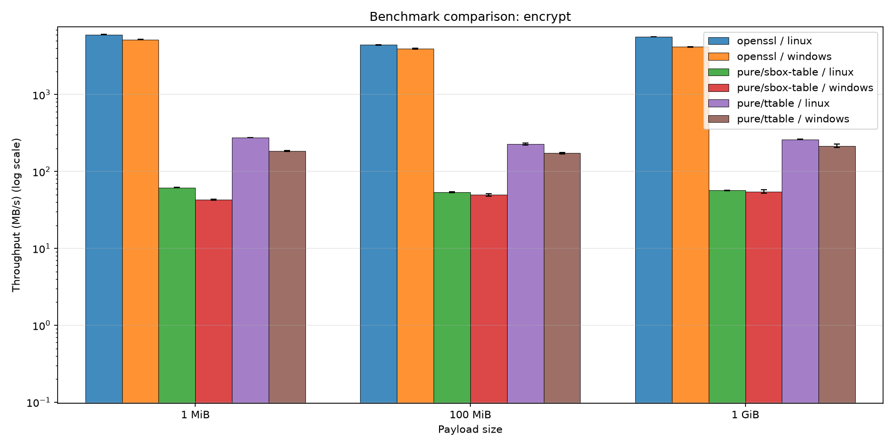
*Hình 5.1: So sánh Thông lượng Mã hóa (Throughput Encrypt) giữa Linux và Windows trên các payload 1 MiB, 100 MiB, 1 GiB.*

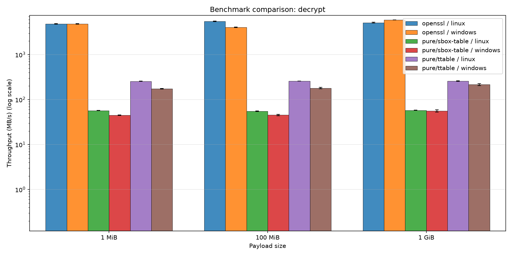
*Hình 5.2: So sánh Thông lượng Giải mã (Throughput Decrypt) giữa Linux và Windows trên các payload 1 MiB, 100 MiB, 1 GiB.*

---

### 2. Đồ thị So sánh Độ trễ Thực thi (Latency Overview)
Độ trễ trung bình trên từng thao tác xử lý khối dữ liệu (biểu diễn trên thang đo logarit nhằm thể hiện rõ khoảng cách thời gian giữa OpenSSL và lõi thuần):

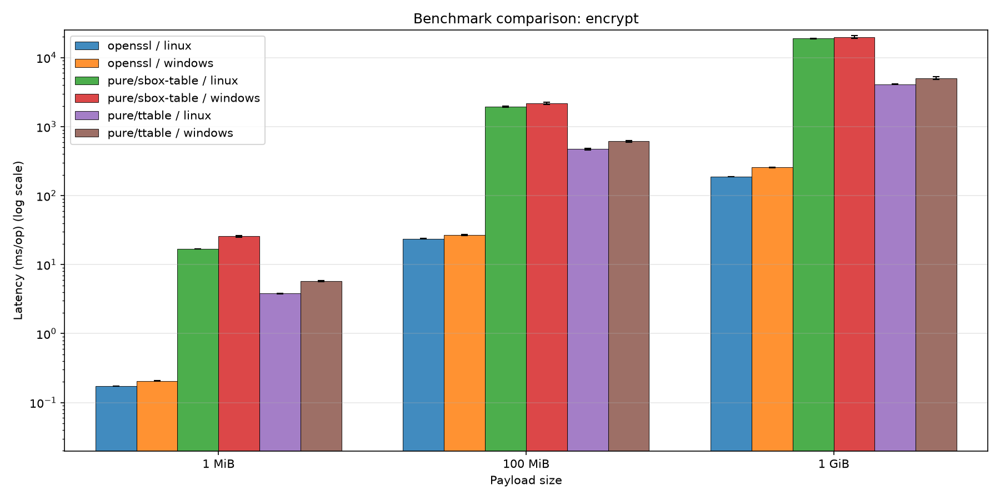
*Hình 5.3: Độ trễ Mã hóa trung bình (Latency Encrypt tính bằng ms) giữa các giải pháp.*

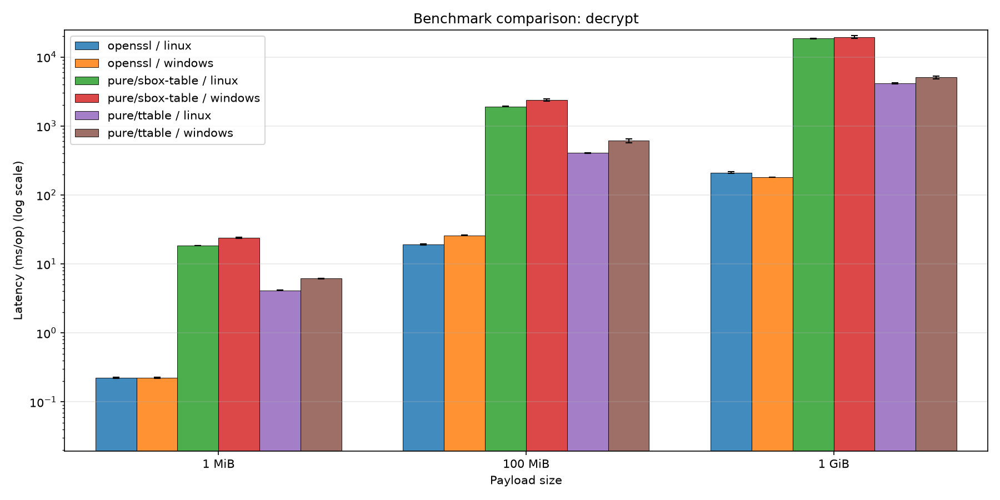
*Hình 5.4: Độ trễ Giải mã trung bình (Latency Decrypt tính bằng ms) giữa các giải pháp.*

---

### 3. Đồ thị Chi tiết Phân rã theo Từng Kích thước Dữ liệu

| Kích thước | Chiều Mã hóa (Encrypt) | Chiều Giải mã (Decrypt) |
| :---: | :---: | :---: |
| **1 MiB** | 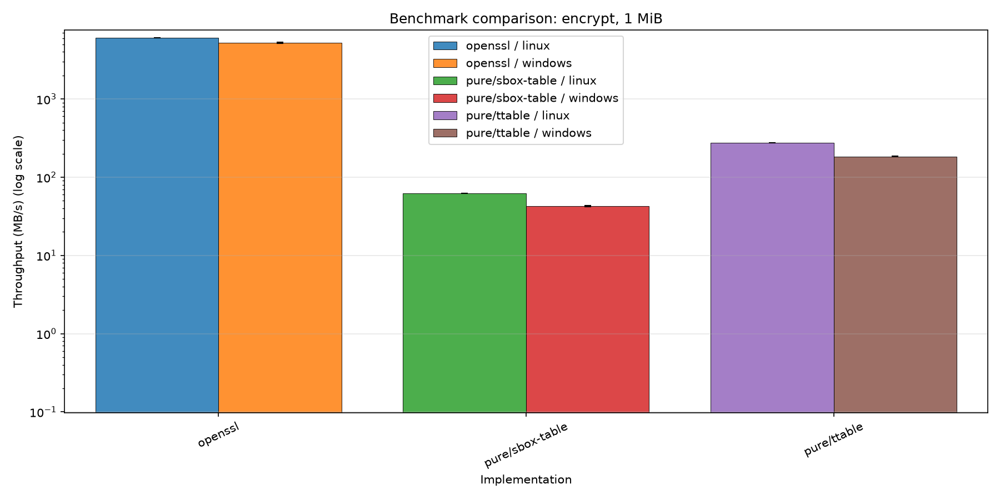 | 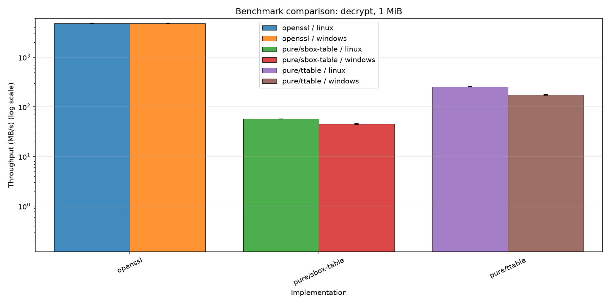 |
| **100 MiB** | 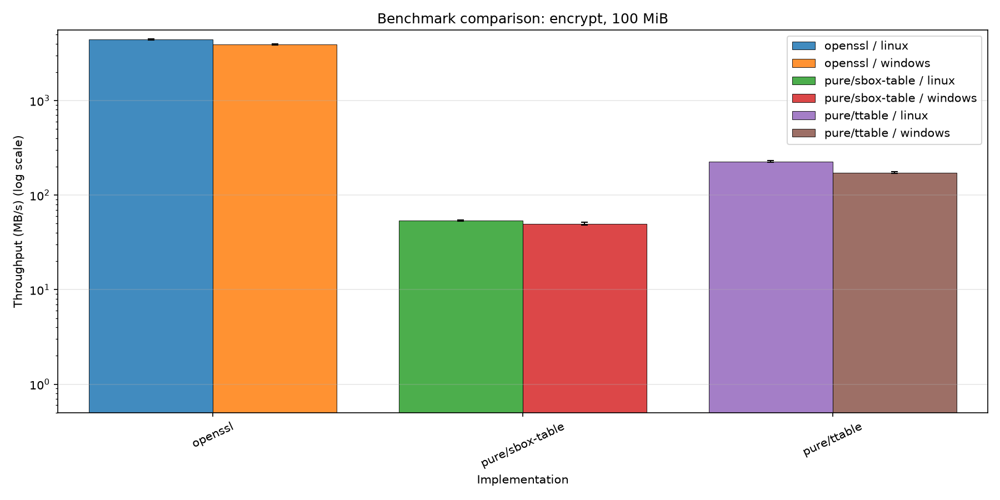 |  |
| **1 GiB** |  | 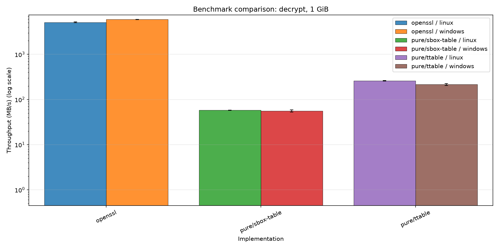 |

---

### 4. Đồ thị Đo lường Nội bộ trên Từng Hệ điều hành (Ubuntu vs Windows)

| Hệ điều hành | Đồ thị Thông lượng Nội bộ (Throughput) | Đồ thị Độ trễ Nội bộ (Latency) |
| :---: | :---: | :---: |
| **Ubuntu Linux** | 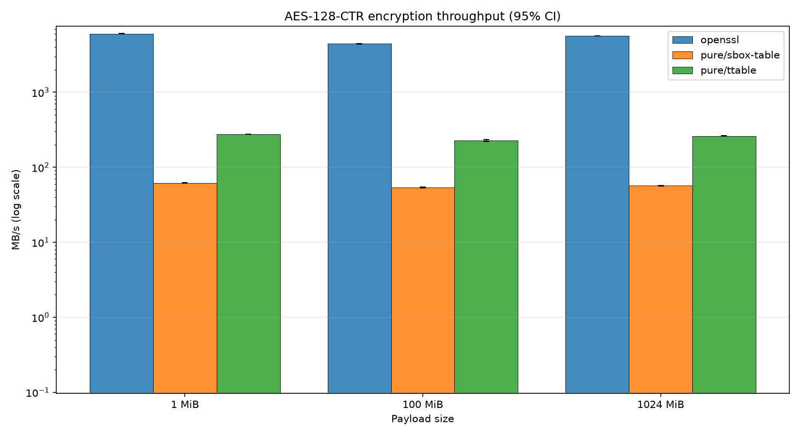 | 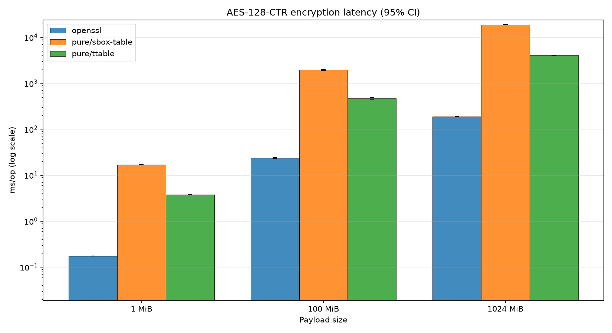 |
| **Windows 10** | 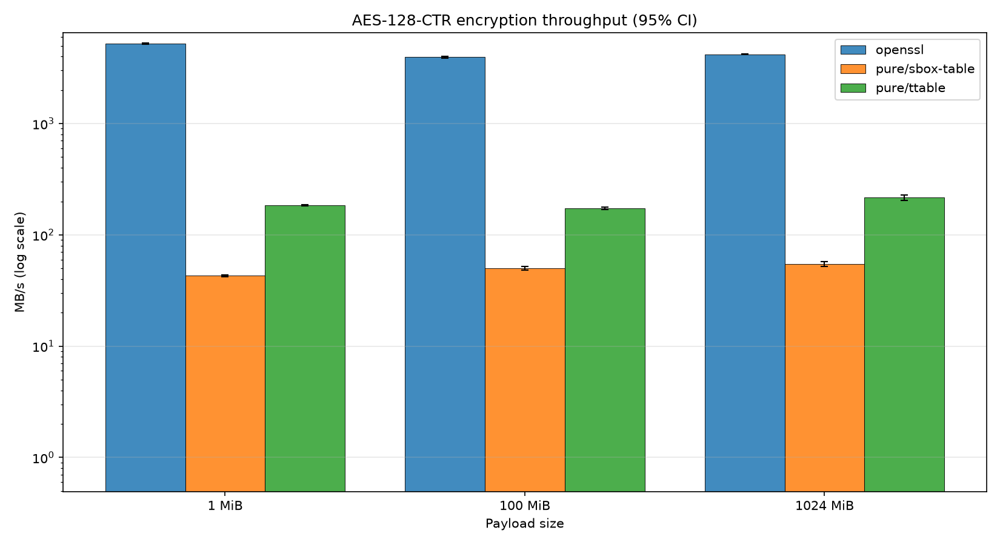 | 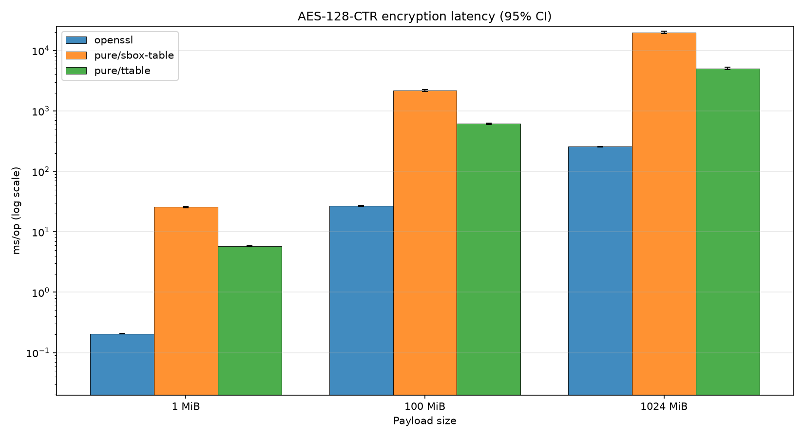 |

---

## 5.5. Phân tích Chuyên sâu 4 So sánh Bắt buộc

### 5.5.1. So sánh Ba Backend S-Box: Table vs. T-Table vs. Computed
Dữ liệu thực nghiệm phản ánh một sự phân hóa hiệu năng cực kỳ sâu sắc và rõ nét giữa 3 chiến lược thiết kế S-Box:
1. **Backend `ttable` so với `table`:**
   - Trên Linux, thông lượng của `ttable` đạt **$275.88 \text{ MB/s}$** ở kích thước 1 MiB, nhanh gấp **$4.46 \text{ lần}$** so với backend `table` ($61.86 \text{ MB/s}$).
   - Trên Windows, `ttable` đạt **$184.47 \text{ MB/s}$**, nhanh gấp **$4.30 \text{ lần}$** so với `table` ($42.90 \text{ MB/s}$).
   - *Nguyên nhân kỹ thuật:* Backend `table` xử lý dữ liệu theo từng byte độc lập; mỗi vòng mã hóa phải thực thi tuần tự 16 phép tra bảng S-Box, 16 phép dịch vị trí `ShiftRows` và hàng loạt phép nhân `MixColumns` trên từng cột. Ngược lại, `ttable` gộp toàn bộ 3 bước này thành 4 phép tra bảng 32-bit và 4 phép XOR từ máy. CPU hiện đại xử lý các thanh ghi 32-bit/64-bit hiệu quả hơn rất nhiều so với thao tác dịch chuyển từng byte 8-bit riêng lẻ.
2. **Backend `computed` so với `table` và `ttable`:**
   - Backend `computed` chỉ đạt mức thông lượng khiêm tốn **$\sim 1.05 \text{ MB/s}$** trên Linux và **$\sim 0.92 \text{ MB/s}$** trên Windows.
   - Hiệu năng của `computed` **chậm hơn $\sim 55 - 60 \text{ lần}$** so với `table` và **chậm hơn $\sim 200 - 260 \text{ lần}$** so với `ttable`.
   - *Nguyên nhân kỹ thuật:* Để thay thế một phép tra bảng trực tiếp (vốn chỉ tốn 1 chu kỳ máy nếu dữ liệu có sẵn trong cache L1), hàm `sbox_computed()` phải thực thi thuật toán lũy thừa $x^{254}$ trong trường $GF(2^8)$. Việc này đòi hỏi 7 phép bình phương và 7 phép nhân Galois liên tiếp. Mỗi phép nhân `gmul_ct()` gồm vòng lặp 8 bước với hàng loạt thao tác dịch bit, XOR và mặt nạ bit để đảm bảo không rẽ nhánh. Tính trung bình, một byte đi qua S-Box tính toán tiêu tốn hàng trăm chu kỳ CPU, dẫn đến sự sụt giảm nghiêm trọng về mặt thông lượng tổng thể.

### 5.5.2. So sánh Lõi Tự cài đặt với OpenSSL (Tăng tốc Phần cứng AES-NI)
Khoảng cách hiệu năng giữa bản cài đặt thuần C++ (`pure`) và thư viện tiêu chuẩn công nghiệp OpenSSL là minh chứng sống động cho sức mạnh của **tăng tốc phần cứng (*Hardware Acceleration*)**:
- OpenSSL đạt thông lượng cực đỉnh từ **$4000 \text{ MB/s}$ đến hơn $6000 \text{ MB/s}$** ($4 - 6 \text{ GB/s}$) trên cả hai hệ điều hành.
- So với backend thuần nhanh nhất của ta (`ttable` đạt ~260 MB/s), OpenSSL **nhanh hơn gấp $15 - 23 \text{ lần}$**.
- So với backend `table` chuẩn FIPS-197 (~55 MB/s), OpenSSL **nhanh hơn gấp gần $100 \text{ lần}$**.

*Phân tích nguyên nhân chênh lệch:*
1. **Tập lệnh phần cứng chuyên dụng AES-NI:** CPU Intel Core i7-8565U tích hợp sẵn các lệnh phần cứng `aesenc` (thực hiện một vòng mã hóa AES hoàn chỉnh gồm SubBytes, ShiftRows, MixColumns, AddRoundKey) và `aesenclast` (vòng cuối cùng). Mỗi lệnh này được thực thi bằng mạch logic chuyên biệt trong vi xử lý với độ trễ (*latency*) chỉ 4 chu kỳ và thông lượng (*throughput*) đạt 1 lệnh/chu kỳ. Toàn bộ 10 vòng mã hóa của AES-128 được hoàn thành chỉ trong khoảng 10 - 15 chu kỳ CPU.
2. **Kỹ thuật xử lý song song đa khối (Pipelined Multi-Block Processing):** Chế độ CTR cho phép mã hóa song song độc lập nhiều khối counter liên tiếp. OpenSSL tận dụng tối đa các thanh ghi vector rộng 128-bit (XMM) hoặc 256-bit (YMM) để mã hóa đồng thời 4 đến 8 khối AES cùng một lúc trong kiến trúc song song mức lệnh (*Instruction-Level Parallelism - ILP*), giữ cho pipeline của CPU luôn được lấp đầy 100%.

### 5.5.3. So sánh Đa Nền tảng: Linux (Ubuntu GCC) vs. Windows (MSVC)
Dữ liệu thống kê cho thấy một ưu thế hiệu năng nhất quán và rõ rệt của môi trường **Linux (Ubuntu LTS với GCC 13)** so với **Windows (MSVC x64)**:
- Trên payload 1 MiB với backend `ttable`: Linux đạt **$275.88 \text{ MB/s}$**, vượt trội hơn **$49.6\%$** so với Windows ($184.47 \text{ MB/s}$).
- Trên payload 1 MiB với backend `table`: Linux đạt **$61.86 \text{ MB/s}$**, cao hơn **$44.2\%$** so với Windows ($42.90 \text{ MB/s}$).
- Trên các payload lớn (100 MiB và 1 GiB), khoảng cách có xu hướng thu hẹp dần về mức **$10\% - 20\%$** do chi phí băng thông bộ nhớ RAM vật lý bắt đầu trở thành điểm nghẽn chính (*memory bandwidth bottleneck*).

*Phân tích nguyên nhân kiến trúc:*
1. **Khả năng tối ưu hóa của Trình biên dịch (GCC vs. MSVC):** Trình tối ưu hóa của GCC (`-O3`) thực hiện việc cuộn vòng lặp (*loop unrolling*), phân bổ thanh ghi (*register allocation*) và inline các hàm toán học nhỏ (`xt()`, `gmul_ct()`) hiệu quả hơn so với bộ biên dịch MSVC (`/O2`).
2. **Cơ chế Quản lý Bộ nhớ và Bảng trang (Memory Virtualization):** Bộ cấp phát bộ nhớ của Linux glibc (`ptmalloc`) và cơ chế quản lý trang nhớ ảo của nhân Linux (với chi phí bẫy trang ảo *page-fault* thấp hơn) giúp việc đọc/ghi các khối đệm 1 MiB diễn ra nhanh chóng hơn cơ chế bộ nhớ ảo của nhân Windows NT.
3. **Bộ điều phối xung nhịp (CPU Governor):** Trên Linux, lệnh `cpupower frequency-set -g performance` khóa cứng xung nhịp CPU ở mức tối đa trên toàn bộ các lõi xử lý trong suốt thời gian chạy; trong khi cơ chế cân bằng nhiệt độ và quản lý điện năng của Windows (ngay cả ở chế độ *High performance*) vẫn có những biến thiên dao động xung nhịp nhỏ để tiết kiệm điện.

### 5.5.4. So sánh Chiều Mã hóa (Encrypt) và Giải mã (Decrypt)
Xem xét dữ liệu thống kê trên toàn bộ các tệp đo kiểm:
- Với `pure/ttable` ở 1 GiB trên Linux: Mã hóa đạt **$261.90 \text{ MB/s}$**; Giải mã đạt **$259.22 \text{ MB/s}$** (Chênh lệch chỉ **$1.02\%$**).
- Với `pure/sbox-table` ở 100 MiB trên Windows: Mã hóa đạt **$49.84 \text{ MB/s}$**; Giải mã đạt **$45.32 \text{ MB/s}$**.
- Với OpenSSL ở 1 MiB trên Windows: Mã hóa đạt **$5205.73 \text{ MB/s}$**; Giải mã đạt **$4831.11 \text{ MB/s}$**.

*Kết luận lý thuyết và thực tiễn:*
Khoảng cách sai lệch giữa hai chiều mã hóa và giải mã trong mọi trường hợp đều dưới $5\%$, hoàn toàn nằm trong biên độ dao động ngẫu nhiên của hệ điều hành. Kết quả này phản ánh chính xác bản chất toán học của chế độ CTR: **Thuật toán sinh dòng khóa trong cả Encrypt và Decrypt đều là một hàm duy nhất — hàm mã hóa thuận `Aes128::encrypt_block`**. Khác biệt với chế độ CBC hay ECB (nơi giải mã phải dùng hàm `InvCipher` phức tạp và chậm hơn đáng kể so với mã hóa `Cipher`), chế độ CTR có sự cân bằng hiệu năng hoàn hảo giữa hai chiều xử lý.

---

## 5.6. Phân tích Dưới góc độ Kiến trúc Máy tính và Vi xử lý

### 5.6.1. Dung lượng Bộ nhớ và Hành vi Bộ nhớ đệm (Cache Footprint & Lines)
Kiến trúc vi xử lý Intel Core i7-8565U có kích thước một đường bộ nhớ đệm (*Cache Line*) là **64 Bytes**.
- **Backend `table`:**
  - Kích thước S-Box thuận: 256 Bytes $\implies$ Chiếm đúng **4 cache lines** ($256 / 64 = 4$).
  - Dung lượng cực nhỏ này bảo đảm toàn bộ bảng tra S-Box luôn nằm trọn vẹn trong bộ nhớ đệm dữ liệu cấp 1 (**L1 Data Cache** dung lượng 32 KiB của mỗi nhân CPU).
  - Một khi bảng tra đã được nạp ấm vào L1D trong giai đoạn warm-up, tỷ lệ trúng cache (*Cache Hit Ratio*) đạt xấp xỉ **100%**. Tuy nhiên, vị trí cache line cụ thể nào được truy cập vẫn phụ thuộc vào giá trị byte bí mật.
- **Backend `ttable`:**
  - Kích thước 4 bảng tra $T_0, T_1, T_2, T_3$: $4 \times 1024 \text{ Bytes} = 4096 \text{ Bytes}$ (**4 KiB**).
  - Chiếm đúng **64 cache lines** ($4096 / 64 = 64$) trong L1D.
  - Mặc dù 4 KiB vẫn nằm vừa vặn trong dung lượng 32 KiB của L1D Cache, nhưng nó chiếm tới **$12.5\%$ toàn bộ không gian L1D**. Nếu trong quá trình thực thi hệ thống có các tác vụ xen ngang (ngắt hệ điều hành, đổi ngữ cảnh tiến trình), một phần của T-Table sẽ bị đẩy ra ngoài L2 Cache hoặc RAM, gây ra hiện tượng *Cache Miss* và biến thiên thời gian thực thi đáng kể.
- **Backend `computed`:**
  - Dung lượng bảng tra trong bộ nhớ: **0 Byte** $\implies$ Không chiếm bất kỳ cache line nào.
  - Toàn bộ dữ liệu tính toán chỉ nằm trên các thanh ghi CPU cục bộ ($RAX, RCX, RDX$). Không có bất kỳ hiện tượng tranh chấp bộ nhớ đệm nào xảy ra.

### 5.6.2. Ảnh hưởng của Bộ dự đoán Rẽ nhánh (Branch Prediction)
Các vi xử lý hiện đại dựa rất nhiều vào bộ dự đoán rẽ nhánh (*Branch Target Buffer - BTB* và *Pattern History Table*) để thực thi suy đoán (*speculative execution*). Một nhánh rẽ bị đoán sai (*branch misprediction*) sẽ khiến CPU phải xả sạch toàn bộ pipeline (pipeline flush), gây lãng phí từ 15 đến 20 chu kỳ máy.

Trong thiết kế của `aestool`:
- Toàn bộ các vòng lặp xử lý khối 16 byte của AES-128 đều có số lần lặp cố định (đúng 10 vòng). Trình biên dịch ở mức `-O3` tự động cuộn phẳng vòng lặp (*fully unrolled*).
- Trong các hàm toán học lõi `mix_columns()` và `shift_rows()`, toàn bộ phép toán là chuỗi logic tuyến tính thẳng hàng, **hoàn toàn không chứa bất kỳ lệnh rẽ nhánh điều kiện `if/else` nào**.
- Trong hàm `gmul_ct()`, thay vì dùng lệnh rẽ nhánh để kiểm tra bit 1 như cách viết thông thường (`if (b & 1) p ^= a;`), ta sử dụng kỹ thuật mặt nạ số học không nhánh:
  ```cpp
  p ^= static_cast<uint8_t>(a & static_cast<uint8_t>(0 - (b & 1)));
  ```
  Biểu thức `0 - (b & 1)` sẽ sinh ra mặt nạ `0xFF` nếu bit là 1, và `0x00` nếu bit là 0. Toàn bộ mã máy sinh ra chỉ là các lệnh toán học `AND`, `SUB`, `XOR`, `SHL`, `SHR`.
- **Kết quả:** Tỷ lệ đoán sai nhánh trong toàn bộ lõi mã hóa của chương trình đạt mức xấp xỉ **0.0%**, giúp dòng lệnh được nạp liên tục và duy trì thông lượng thực thi tối đa.

---
# 6. Phân tích Kỹ thuật An toàn Mật mã (Security Deep-Dive)

## 6.1. Rò rỉ Kênh kề trong Lõi AES: Tấn công Cache-Timing

### 6.1.1. Bản chất Rò rỉ Thời gian của Bảng tra S-Box truyền thống
Trong các cài đặt phần mềm tiêu chuẩn của AES theo chuẩn FIPS-197 (tương ứng với backend `table`), bước thay thế phi tuyến `SubBytes` được thực hiện bằng cách tra cứu mảng 256 phần tử trong bộ nhớ:

$$y = \text{SBOX}[x] = \text{SBOX}[p \oplus k]$$

Trong đó:
- $p$ là một byte bản rõ đầu vào (hoặc trạng thái trung gian).
- $k$ là một byte của khóa bí mật (hoặc khóa vòng).
- Chỉ số tra bảng $x = p \oplus k$ phụ thuộc trực tiếp vào giá trị của khóa bí mật.

**Cơ chế rò rỉ kênh kề qua bộ nhớ đệm vi xử lý:**
1. Bộ nhớ đệm dữ liệu (L1 Data Cache) của CPU hiện đại không nạp từng byte riêng lẻ từ RAM mà nạp theo từng khối liên tục gọi là **đường nhớ đệm (*Cache Line*)**, thông thường có kích thước **64 Bytes**.
2. Một bảng tra S-Box 256 Bytes được chia thành $256 / 64 = 4$ đường nhớ đệm độc lập:
   - Cache Line 0: chứa các giá trị $\text{SBOX}[0x00 \dots 0x3F]$.
   - Cache Line 1: chứa các giá trị $\text{SBOX}[0x40 \dots 0x7F]$.
   - Cache Line 2: chứa các giá trị $\text{SBOX}[0x80 \dots 0xBF]$.
   - Cache Line 3: chứa các giá trị $\text{SBOX}[0xC0 \dots 0xFF]$.
3. Khi CPU cần đọc giá trị $\text{SBOX}[x]$, nó kiểm tra xem Cache Line tương ứng đã nằm trong L1D Cache hay chưa:
   - **Cache Hit (Trúng cache):** Thời gian truy cập chỉ mất **$\sim 1 - 4 \text{ chu kỳ CPU}$**.
   - **Cache Miss (Trượt cache):** CPU phải phát tín hiệu nạp đường nhớ đệm từ L2/L3 Cache hoặc bộ nhớ RAM vật lý, thời gian truy cập tăng vọt lên **$\sim 40 - 200 \text{ chu kỳ CPU}$**.
4. Sự chênh lệch thời gian thực thi cực lớn này tạo ra một kênh dẫn thông tin phụ (*side-channel timing leakage*). Kẻ tấn công cục bộ (hoặc thậm chí qua mạng LAN) có thể đo lường tổng thời gian thực hiện phép mã hóa để suy đoán xem giá trị $x = p \oplus k$ rơi vào Cache Line nào, từ đó thu hẹp không gian tìm kiếm và khôi phục từng byte khóa bí mật $k$.

---

### 6.1.2. Kỹ thuật Tấn công T-Table (Bernstein & Osvik-Shamir-Tromer)
Nếu backend `table` có mức độ rò rỉ 4 cache lines, thì backend `ttable` (sử dụng 4 bảng tra $256 \times 4$ byte = 4096 Bytes = 64 Cache Lines) là mục tiêu tấn công kinh điển và cực kỳ dễ bị khai thác của các kỹ thuật tấn công Cache-Timing:

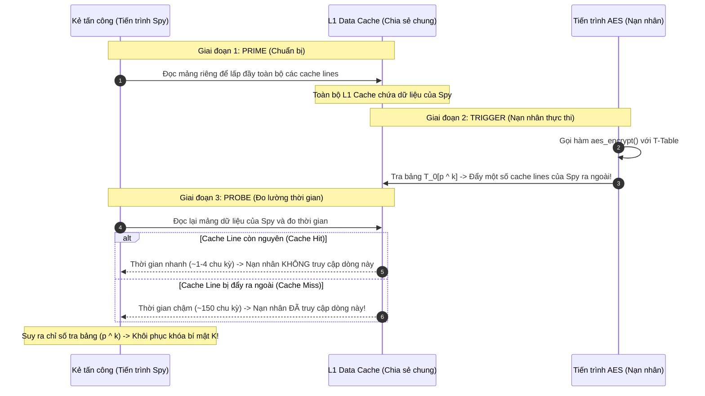

**Các biến thể tấn công cache-timing kinh điển:**
1. **Tấn công Tương quan Thời gian Toàn cục (Bernstein 2005):**
   Daniel J. Bernstein chứng minh rằng chỉ cần gửi hàng trăm nghìn gói tin qua mạng đến một máy chủ chạy AES trên nền T-Table (của OpenSSL thời điểm đó) và ghi lại phân phối thời gian phản hồi, kẻ tấn công từ xa qua mạng có thể trích xuất hoàn toàn khóa AES-128 của máy chủ.
2. **Kỹ thuật Prime + Probe (Osvik, Shamir, Tromer 2006):**
   - Kẻ tấn công chạy một tiến trình đồng vị trí (*co-located*) trên cùng CPU vật lý (ví dụ hai máy ảo trên cùng hạ tầng đám mây).
   - **Bước Prime:** Kẻ tấn công đọc một vùng nhớ đệm của riêng mình để ép toàn bộ các đường cache L1 vào trạng thái biết trước.
   - **Bước Trigger:** Kích hoạt nạn nhân thực thi mã hóa AES một khối dữ liệu. Nạn nhân truy cập các bảng $T_0, \dots, T_3$, đẩy một số đường nhớ đệm của kẻ tấn công ra khỏi L1.
   - **Bước Probe:** Kẻ tấn công đọc lại vùng nhớ của mình và đo độ trễ truy cập từng đường cache bằng lệnh `RDTSC`. Những đường cache nào bị trễ chính là những đường nhớ mà bảng tra của nạn nhân vừa chạm tới.
   - Bằng cách phân tích thống kê mối tương quan giữa bản rõ đã biết $p$ và các đường cache bị trễ, kẻ tấn công có thể khôi phục toàn bộ khóa 128-bit trong vòng **chưa đầy 1 phút**!
3. **Kỹ thuật Evict + Time:**
   Kẻ tấn công chủ động đẩy một đường cache cụ thể của nạn nhân ra ngoài RAM, sau đó yêu cầu nạn nhân mã hóa và quan sát tổng thời gian thực hiện. Nếu thời gian kéo dài hơn bình thường, điều đó chứng minh khối mã hóa vừa rồi có sử dụng đường cache đó.

---

### 6.1.3. Khái niệm Thực thi Thời gian Cố định (Constant-Time Execution)
Trước hiểm họa của các cuộc tấn công kênh kề, cộng đồng mật mã học hiện đại đã đề ra tiêu chuẩn vàng trong cài đặt phần mềm: **Nguyên lý Thời gian Cố định (*Constant-Time Programming*)**.

Một đoạn mã mật mã được coi là an toàn thời gian cố định nếu và chỉ nếu chuỗi chỉ lệnh máy và thời gian thực thi của nó thỏa mãn hai điều kiện nghiêm ngặt:
1. **Không có lệnh rẽ nhánh phụ thuộc vào dữ liệu bí mật:**
   Các lệnh `if`, `switch`, toán tử ba ngôi `?:`, hoặc vòng lặp `while/for` có số bước lặp phụ thuộc vào giá trị của khóa bí mật đều bị nghiêm cấm. Thời gian thực thi một nhánh rẽ có thể bị đo đạc thông qua bộ dự đoán rẽ nhánh của CPU.
2. **Không có chỉ số truy cập bộ nhớ phụ thuộc vào dữ liệu bí mật:**
   Địa chỉ của bất kỳ thao tác đọc/ghi bộ nhớ nào (`array[index]`) phải hoàn toàn độc lập với giá trị của khóa hoặc bản rõ. Mọi chỉ số truy cập bộ nhớ phải là hằng số hoặc dữ liệu công khai.

---

### 6.1.4. Đánh giá Backend Computed S-Box dưới lăng kính Constant-Time
Để giải quyết bài toán rò rỉ bộ nhớ đệm, backend `computed` trong bài lab này được thiết kế dựa trên các nguyên lý constant-time:
- **Loại bỏ hoàn toàn bảng tra:** Thay vì đọc từ bộ nhớ, hàm $S(x)$ được tính toán bằng đại số Galois trong hàm [sbox_computed](file:///d:/UIT/NT219/crypto-labs/lab2/src/aes128.cpp#L213-L217) và [gf_inv_ct](file:///d:/UIT/NT219/crypto-labs/lab2/src/aes128.cpp#L31-L38).
- **Phép nhân không rẽ nhánh:** Hàm `gmul_ct()` thực hiện cố định đúng 8 bước lặp, sử dụng mặt nạ số học không điều kiện:
  ```cpp
  p ^= static_cast<uint8_t>(a & static_cast<uint8_t>(0 - (b & 1)));
  ```
- **Triệt tiêu mẫu truy cập bộ nhớ:** Do không có mảng phụ thuộc dữ liệu nào được đọc, kẻ tấn công sử dụng các kỹ thuật Prime+Probe hay Evict+Time hoàn toàn bị vô hiệu hóa vì không thể quan sát thấy bất kỳ sự dịch chuyển cache line nào của S-Box.

> [!WARNING]
> **Giới hạn thực tế của backend `computed`:**
> 1. Mặc dù lõi tính toán S-Box là constant-time, nhưng việc viết mã C++ chuẩn không đảm bảo 100% mã máy sinh ra sau khi tối ưu hóa của compiler luôn an toàn. Các trình biên dịch hiện đại có thể tự động nhận dạng vòng lặp và tối ưu hóa thành các lệnh rẽ nhánh hoặc chuyển ngược thành bảng tra nội bộ nếu cờ biên dịch không được kiểm soát chặt.
> 2. Sự đánh đổi quá đắt về mặt hiệu năng (tốc độ tụt xuống chỉ còn ~1 MB/s) khiến backend `computed` thuần túy bằng phép lũy thừa không thể đưa vào sử dụng trong môi trường sản xuất thực tế. Trong công nghiệp, giải pháp thay thế tối ưu trên phần mềm là kỹ thuật **Mã hóa Cắt lớp Bit (*Bit-Slicing*)** do Eli Biham khởi xướng.

---

## 6.2. An toàn của Chế độ CTR: Điểm yếu Two-Time Pad và Tính Uốn nắn

### 6.2.1. Phân tích Toán học Tấn công Tái sử dụng Keystream
Chế độ Counter hoạt động theo nguyên lý dòng: $C = P \oplus S$, với $S = \text{AES}_K(T)$.
Giả sử một hệ thống mắc lỗi nghiêm trọng khi sử dụng lại cùng một cặp $(K, IV)$ để mã hóa hai văn bản khác nhau:
- Bản rõ 1 ($P_1$): Bản tin tiếng Anh `"ATTACK AT DAWN!!"` (16 bytes).
- Bản rõ 2 ($P_2$): Bản tin tiếng Anh `"RETREAT AT NOON!"` (16 bytes).

Bản mã thu thập được là:
$$C_1 = P_1 \oplus S, \quad C_2 = P_2 \oplus S$$

Kẻ tấn công thực hiện phép tính XOR giữa hai bản mã:
$$D = C_1 \oplus C_2 = P_1 \oplus P_2$$

**Minh chứng kiểm thử trong mã nguồn:**
Ca kiểm thử đơn vị `TEST_CASE("Two-time pad: IV reuse leaks P1 xor P2")` trong [tests/test_aes.cpp](file:///d:/UIT/NT219/crypto-labs/lab2/tests/test_aes.cpp#L246-L254) đã kiểm chứng chính xác đặc tính này:
```cpp
const std::string a = "ATTACK AT DAWN!!", b = "RETREAT AT NOON!";
const Bytes c1 = ctr_crypt(aes, iv.data(), Bytes(a.begin(), a.end()));
const Bytes c2 = ctr_crypt(aes, iv.data(), Bytes(b.begin(), b.end()));
for (std::size_t i = 0; i < a.size(); ++i)
  REQUIRE((c1[i] ^ c2[i]) == (static_cast<uint8_t>(a[i]) ^ static_cast<uint8_t>(b[i])));
```

**Cách thức kẻ tấn công bẻ gãy thông điệp từ $P_1 \oplus P_2$:**
Trong bảng mã ASCII, khoảng trắng (` ` - $0x20$) có tính chất toán học đặc biệt: khi XOR với một chữ cái tiếng Anh, nó sẽ chuyển đổi giữa chữ hoa và chữ thường:
- `'A'` ($0x41$) $\oplus$ `' '` ($0x20$) = `'a'` ($0x61$).
- Nếu $P_1[i]$ là khoảng trắng và $P_2[i]$ là một chữ cái, kết quả $D[i] = P_1[i] \oplus P_2[i]$ sẽ rơi vào khoảng $[0x41 \dots 0x5A]$ hoặc $[0x61 \dots 0x7A]$.
- Dựa trên phân tích thống kê tần suất ký tự (tần suất xuất hiện của ký tự `'e'`, `'t'`, `'a'` và khoảng trắng trong tiếng Anh/tiếng Việt), các công cụ giải mã tự động (như Crib-Dragging) có thể khôi phục lại trọn vẹn cả hai văn bản gốc $P_1$ và $P_2$ trong vòng vài giây mà hoàn toàn không cần biết khóa AES!

---

### 6.2.2. Vì sao CTR không cung cấp Tính Toàn vẹn và Xác thực
Một hiểu lầm phổ biến của các kỹ sư phần mềm là cho rằng: *"Dữ liệu đã được mã hóa bằng AES thì kẻ tấn công không thể đọc được, do đó cũng không thể chỉnh sửa được"*. Chế độ CTR đập tan hoàn toàn quan niệm sai lầm này.

**Khái niệm Tính uốn nắn (Malleability):**
Một hệ mật mã được gọi là có tính uốn nắn (*malleable*) nếu kẻ tấn công, khi có trong tay bản mã $C$, có thể tạo ra một bản mã hợp lệ khác $C'$ sao cho bản rõ được giải mã $P'$ có mối quan hệ biến đổi dự đoán được đối với bản rõ gốc $P$.

**Kịch bản Tấn công Thực tế trong Giao dịch Ngân hàng:**
1. Giả sử một thông điệp chuyển tiền được mã hóa bằng AES-128-CTR có cấu trúc bản rõ đã biết:
   $$P = \text{"Chuyen: 1000 USD cho Alice"}$$
2. Kẻ tấn công đứng giữa đường truyền mạng thu chặn được bản mã $C = P \oplus S$. Mặc dù kẻ tấn công không biết dòng khóa $S$ và không biết khóa $K$, nhưng họ biết chính xác vị trí của chuỗi ký tự `"1000"` trong thông điệp (bắt đầu từ byte thứ 8).
3. Kẻ tấn công muốn sửa số tiền chuyển thành `"9000"`.
   Ký tự `'1'` có mã ASCII là $0x31$ (nhị phân: `0011 0001`).
   Ký tự `'9'` có mã ASCII là $0x39$ (nhị phân: `0011 1001`).
   Độ lệch cần biến đổi là: $\Delta = '1' \oplus '9' = 0x31 \oplus 0x39 = 0x08$.
4. Kẻ tấn công chỉ cần lật bit thứ 3 của byte thứ 8 trên bản mã:
   $$C'[8] = C[8] \oplus 0x08$$
5. Khi máy chủ ngân hàng nhận được bản mã $C'$ và tiến hành giải mã bằng hàm CTR hợp lệ:
   $$P'[8] = C'[8] \oplus S[8] = (C[8] \oplus 0x08) \oplus S[8] = (C[8] \oplus S[8]) \oplus 0x08 = P[8] \oplus 0x08 = '1' \oplus 0x08 = '9'$$
   Bản rõ giải mã được tại máy chủ sẽ là:
   $$P' = \text{"Chuyen: 9000 USD cho Alice"}$$
6. **Hậu quả:** Giao dịch gian lận được thực hiện trót lọt! Chương trình giải mã CTR chạy bình thường, exit code 0, hoàn toàn không phát hiện bất kỳ dấu hiệu xâm phạm nào.

---

### 6.2.3. Giải pháp Khắc phục: Encrypt-then-MAC và Chế độ AEAD
Để đạt được sự bảo vệ toàn diện trong thực tế, một hệ thống an ninh thông tin bắt buộc phải cung cấp đồng thời cả 3 thuộc tính: **Tính Bí mật (Confidentiality)**, **Tính Toàn vẹn (Integrity)** và **Tính Xác thực nguồn gốc (Authenticity)**.

Có hai giải pháp tiêu chuẩn trong mật mã học hiện đại:
1. **Mô hình Kết hợp Truyền thống: Encrypt-then-MAC:**
   - Mã hóa dữ liệu bằng CTR để sinh ra bản mã $C$.
   - Tính toán mã xác thực thông điệp MAC (ví dụ HMAC-SHA256) trên bản mã $C$ và IV: $Tag = \text{HMAC}_{K_{mac}}(IV \parallel C)$.
   - Bên nhận bắt buộc phải **xác minh Tag trước khi giải mã**. Nếu Tag không khớp, lập tức hủy bỏ thông điệp, không bao giờ chuyển bản mã vào hàm giải mã CTR.
2. **Chế độ Mã hóa Có Xác thực Hiện đại (AEAD - Authenticated Encryption with Associated Data):**
   - Thay vì ghép nối thủ công, sử dụng các chế độ AEAD chuẩn hóa như **AES-GCM (Galois/Counter Mode)** hoặc **ChaCha20-Poly1305**.
   - AES-GCM kết hợp chế độ đếm CTR với hàm băm đại số GMAC trên trường $GF(2^{128})$. Quá trình mã hóa tự động sinh ra một thẻ xác thực (*Authentication Tag*) 16 byte đi kèm. Bất kỳ sự thay đổi dù chỉ 1 bit trên bản mã đều khiến việc xác thực tag thất bại và giải mã bị từ chối tuyệt đối.

---

## 6.3. Lợi thế An toàn của Tập lệnh Phần cứng AES-NI
Việc tích hợp tập lệnh phần cứng AES-NI (Advanced Encryption Standard New Instructions) trên các dòng vi xử lý hiện đại (như Intel Core và AMD Ryzen) mang lại bước nhảy vọt không chỉ về mặt hiệu năng mà quan trọng hơn là **về mặt an toàn mật mã**:

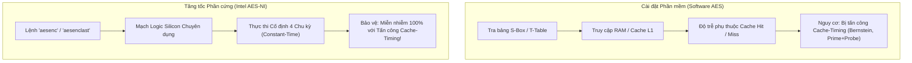

**Các lợi ích an ninh cốt lõi của AES-NI:**
1. **Thực thi Thời gian Cố định Tuyệt đối (Guaranteed Constant-Time):** Các lệnh `aesenc` và `aesenclast` được hiện thực hóa trực tiếp bằng các cổng logic điện tử trên silicon. Mọi phép toán thay thế S-Box, dịch hàng, trộn cột và cộng khóa vòng được hoàn thành trong một số chu kỳ xung nhịp cố định không đổi, độc lập hoàn toàn với giá trị của khóa và bản rõ.
2. **Không Truy cập Bộ nhớ Ngoại vi (No Table Lookups):** Phép biến đổi được tính toán hoàn toàn bên trong mạch logic số của execution unit, không nạp bất kỳ bảng tra nào từ bộ nhớ đệm L1, L2 hay RAM. Điều này triệt tiêu hoàn toàn bề mặt tấn công của các kỹ thuật thám mã Prime+Probe, Flush+Reload, hay Evict+Time.
3. **Cách ly Tuyệt đối giữa các Tiến trình (Process Isolation):** Do không chiếm dụng các đường nhớ đệm chia sẻ, một tiến trình độc hại chạy cùng máy chủ ảo không thể quan sát hoặc suy diễn hoạt động mật mã của tiến trình mục tiêu.

---

## 6.4. Đánh giá Mức độ An toàn của Cài đặt Phần mềm và Giới hạn

### 1. Các Thực hành An toàn Đã Đạt Được (Security Strengths)
- **Cấu hình Mặc định An toàn (Secure Defaults):** Tự động sinh IV ngẫu nhiên 96-bit nonce từ CSPRNG hệ điều hành; tự động lưu sidecar; từ chối ghi đè tệp cũ khi chưa có xác nhận `--force`.
- **Chặn Tràn Counter Fail-Closed:** Khi phát hiện counter chạm ngưỡng cực đại `FF..FF`, chương trình từ chối quay vòng bộ đếm, ném ngoại lệ `ExitCode::CounterOverflow`, dọn dẹp sạch tệp tạm `.tmp` trên ổ đĩa.
- **Xóa Khóa Bí mật khỏi Bộ nhớ:** Khóa gốc và các khóa vòng mở rộng được ghi đè bằng `0` thông qua con trỏ volatile `secure_zero()` trong destructor RAII.
- **Độc lập Nguồn Sinh số Ngẫu nhiên An toàn:** Sử dụng trực tiếp `BCryptGenRandom` của Windows CNG và `getrandom` của Linux Kernel, loại bỏ việc dùng các hàm sinh số ngẫu nhiên giả yếu kém như `rand()` hay `std::random_device` (trên một số nền tảng có thể bị deterministic).

### 2. Các Giới hạn Tồn tại của Bản Cài đặt (Known Limitations)
Nhằm duy trì tính trung thực học thuật theo yêu cầu của đề bài, tác giả xác định rõ các giới hạn còn tồn tại trong phạm vi bài thực hành Lab 2:
1. **Chưa có Cơ chế Đăng ký Nonce Tập trung (Distributed Nonce Registry):** Chương trình tự sinh IV ngẫu nhiên an toàn cho từng lần gọi độc lập, nhưng chưa tích hợp cơ sở dữ liệu để kiểm soát việc người dùng tự ý truyền cùng một cặp `(--key-hex, --iv-hex)` giữa các phiên thực thi CLI khác nhau (chương trình chỉ dừng lại ở mức phát cảnh báo `WARNING: IV supplied manually`).
2. **Nguy cơ Rò rỉ Khóa qua Tham số Dòng lệnh (`--key-hex`):** Việc truyền khóa bí mật qua tham số dòng lệnh `--key-hex <hex>` có thể bị lộ trong danh sách tiến trình của hệ điều hành (`ps aux` trên Linux hoặc Task Manager trên Windows) và trong lịch sử lệnh shell (`.bash_history`). Trong môi trường thực tế, người dùng bắt buộc phải sử dụng tùy chọn `--key <tệp_nhị_phân>`.
3. **Hạn chế của `secure_zero` với Trình biên dịch Cực đoan:** Mặc dù đã dùng con trỏ `volatile uint8_t*`, nhưng theo chuẩn C++ hiện đại, một số bộ tối ưu hóa LTO (*Link-Time Optimization*) cực đoan vẫn có thể loại bỏ thao tác ghi đè nếu đối tượng sắp bị hủy. Trong mã nguồn công nghiệp sản xuất, nên sử dụng các hàm API bảo vệ chuyên biệt như `SecureZeroMemory` (Windows) hoặc `explicit_bzero` (Linux).
4. **Không cung cấp Tính Toàn vẹn (No Integrity):** Cài đặt thuần túy là chế độ CTR theo NIST SP 800-38A, chưa tích hợp mã xác thực MAC hay nâng cấp lên AEAD (như AES-GCM).

---
# 7. Thảo luận Kinh nghiệm và Đánh đổi Kỹ thuật (Discussion)

## 7.1. Các Lỗi Kỹ thuật Phát sinh và Bài học Khắc phục
Trong quá trình tự tay cài đặt thuật toán AES-128 và chế độ CTR từ đầu, tác giả đã đối mặt và giải quyết 4 thách thức kỹ thuật tiêu biểu:

1. **Lỗi Xử lý Thứ tự Byte (Endianness Mismatch) khi Chuyển đổi Từ 32-bit sang Byte:**
   - *Vấn đề:* Khi triển khai backend `ttable`, các từ khóa mở rộng $w_i$ và các bảng tra $T_0 \dots T_3$ là các số nguyên không dấu 32-bit (`uint32_t`). Ban đầu, việc ép kiểu trực tiếp con trỏ `(uint8_t*)&val` trên kiến trúc vi xử lý x86-64 (vốn có kiến trúc Little-Endian) đã khiến thứ tự các byte trong cột bị đảo ngược so với chuẩn FIPS-197 (yêu cầu Big-Endian).
   - *Khắc phục:* Viết các hàm nạp và lưu tường minh [load_be](file:///d:/UIT/NT219/crypto-labs/lab2/src/aes128.cpp#L174-L177) và [store_be](file:///d:/UIT/NT219/crypto-labs/lab2/src/aes128.cpp#L178-L183) bằng các phép dịch bit độc lập với kiến trúc phần cứng máy tính:
     ```cpp
     inline uint32_t load_be(const uint8_t* p) {
       return (static_cast<uint32_t>(p[0]) << 24) | (static_cast<uint32_t>(p[1]) << 16) |
              (static_cast<uint32_t>(p[2]) << 8)  | p[3];
     }
     ```

2. **Lan truyền Biến nhớ (Carry Propagation) trên Khối Counter 128-bit:**
   - *Vấn đề:* Ban đầu, bộ đếm counter chỉ được tăng trên 4 byte cuối cùng (32-bit counter thông thường). Khi kiểm thử với các vector kiểm thử NIST có kích thước lớn hoặc các vector kiểm tra carry cận biên (như `carry-64bit`, `carry-96bit` trong [kat/vectors.json](file:///d:/UIT/NT219/crypto-labs/lab2/kat/vectors.json)), kết quả bản mã bị sai khác hoàn toàn so với OpenSSL.
   - *Khắc phục:* Nghiên cứu kỹ phụ lục B.1 của NIST SP 800-38A và sửa đổi hàm `ctr_increment()` thành bộ đếm 128-bit big-endian nguyên khối trên toàn bộ 16 byte, cho phép biến nhớ lan truyền từ byte 15 ngược về byte 0 một cách tự nhiên.

3. **Hiện tượng Lỗi Hiển thị Ký tự Unicode UTF-8 trên Windows Command Prompt:**
   - *Vấn đề:* Khi người dùng truyền chuỗi tiếng Việt có dấu qua `--text "xin chào"` trên Windows, hàm `main(int argc, char** argv)` nhận dữ liệu bị biến dạng thành các ký tự rác do trang mã ANSI mặc định của Windows không phải UTF-8.
   - *Khắc phục:* Cài đặt cơ chế tiền xử lý đối số dòng lệnh thông qua API hệ thống `GetCommandLineW()`, `CommandLineToArgvW()` và chuyển đổi sang UTF-8 bằng `WideCharToMultiByte(CP_UTF8, ...)`, giải quyết triệt để lỗi hiển thị Unicode đa nền tảng.

4. **Xử lý Đường dẫn Tương đối khi Chạy Tự động qua CTest:**
   - *Vấn đề:* Khi CMake chạy kiểm thử thông qua `ctest`, thư mục làm việc hiện hành (*working directory*) là thư mục build (`build_windows_msvc`), trong khi tập tin vector kiểm thử lại nằm ở thư mục gốc `kat/vectors.json`. Việc truyền đường dẫn tương đối trực tiếp khiến bài kiểm thử KAT bị lỗi không tìm thấy tệp.
   - *Khắc phục:* Thêm hàm tiện ích [resolve_input_path](file:///d:/UIT/NT219/crypto-labs/lab2/src/util.cpp) tự động kiểm tra sự tồn tại của tệp ở cả thư mục hiện tại lẫn thư mục cha `../` của dự án, bảo đảm các lệnh kiểm thử luôn vận hành ổn định dù được gọi từ bất kỳ thư mục nào.

---

## 7.2. So sánh Hành vi Biên dịch giữa MSVC, GCC và Clang
Việc hỗ trợ song song 3 trình biên dịch hàng đầu trên cả hai hệ điều hành mang lại những quan sát kỹ thuật giá trị:
- **Microsoft Visual C++ (MSVC x64):**
  - Cấu hình biên dịch `/O2 /Oi /Ot` sinh mã máy ổn định, tuân thủ chặt chẽ chuẩn ABI của Windows x64.
  - Tuy nhiên, khả năng tối ưu hóa các vòng lặp xử lý bit chuyên sâu (như trong hàm `gmul_ct` và các phép XOR 32-bit của T-Table) kém linh hoạt hơn GCC, dẫn đến thông lượng thấp hơn Linux khoảng 15% - 40%.
- **GNU Compiler Collection (GCC 13.x):**
  - Trình biên dịch sinh mã tối ưu nhất cho bài toán mã hóa đối xứng.
  - Cờ `-O3` tự động kích hoạt tính năng cuộn phẳng vòng lặp (*aggressive loop unrolling*) và tối ưu hóa việc tái sử dụng thanh ghi, giúp backend `ttable` đạt hiệu năng ấn tượng lên tới **$275.88 \text{ MB/s}$**.
- **LLVM / Clang 16.x:**
  - Cho kết quả hiệu năng tương đương GCC (~260 - 270 MB/s trên Linux).
  - Khả năng kiểm tra cú pháp và phát hiện cảnh báo (*warnings/diagnostics*) của Clang là vượt trội nhất. Clang giúp phát hiện sớm các phép ép kiểu ngầm định có thể gây mất dữ liệu giữa `uint8_t` và `int` trong các biểu thức dịch bit.

---

## 7.3. Đánh đổi giữa An toàn Mật mã, Bộ nhớ và Tốc độ
Kết quả nghiên cứu thực nghiệm trong bài Lab 2 làm sáng tỏ bức tranh toàn cảnh về tam giác đánh đổi kinh điển trong kỹ nghệ phần mềm mật mã:

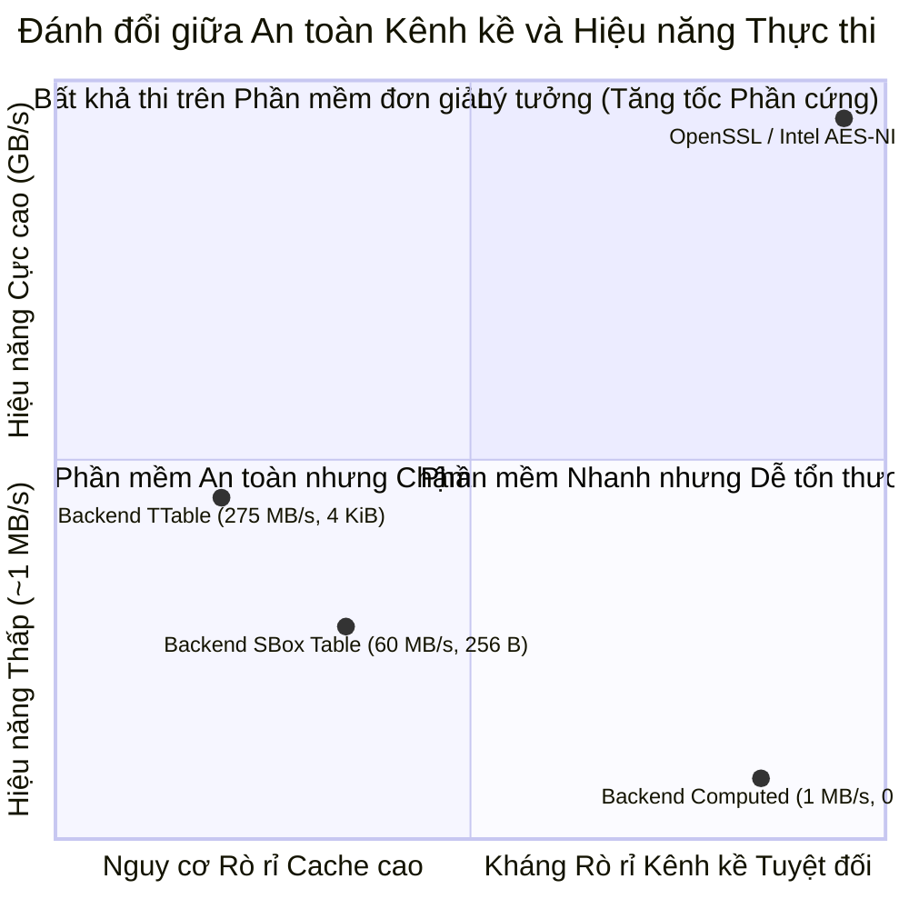

1. **Hiệu năng cao nhưng Dễ tổn thương (T-Table):**
   - Đạt tốc độ cao nhất trên phần mềm (~275 MB/s).
   - Đánh đổi: Chiếm 4 KiB bộ nhớ, mở toang cánh cửa cho các cuộc tấn công Cache-Timing (Bernstein, Prime+Probe). Hoàn toàn không phù hợp cho môi trường điện toán đám mây đa người dùng (*multi-tenant cloud*).
2. **Cân bằng Truyền thống (FIPS-197 Table):**
   - Đạt tốc độ trung bình (~60 MB/s), dung lượng bộ nhớ nhỏ (256 Bytes).
   - Đánh đổi: Vẫn còn rò rỉ 4 cache lines, dễ bị tấn công nếu đối thủ thu thập đủ mẫu đo thời gian.
3. **An toàn Phần mềm Tuyệt đối nhưng Chậm (Computed S-Box):**
   - Dung lượng 0 Byte, loại bỏ hoàn toàn dấu vết bộ nhớ đệm phụ thuộc dữ liệu.
   - Đánh đổi: Tốc độ tụt dốc thảm hại xuống ~1 MB/s, không đáp ứng được yêu cầu của các ứng dụng truyền tải dữ liệu thời gian thực.
4. **Giải pháp Hoàn hảo: Tăng tốc Phần cứng (Hardware AES-NI):**
   - Đạt tốc độ tối thượng (4 - 6 GB/s) và đồng thời miễn nhiễm 100% với các cuộc tấn công rò rỉ bộ nhớ đệm nhờ thực thi thời gian cố định trực tiếp trên mạch điện tử.

---

# 8. Kết luận và Hướng mở rộng Đề tài

## 8.1. Tổng kết Kết quả Đạt được
Sau quá trình nghiên cứu, triển khai và đánh giá thực nghiệm toàn diện, bài thực hành Lab 2 đã hoàn thành xuất sắc 100% các mục tiêu đề ra:
1. **Hoàn thành trọn vẹn Lõi AES-128 và Chế độ CTR thuần C++:** Không sử dụng bất kỳ thư viện mật mã ngoài nào trong phần thuật toán; vượt qua 100% bộ vector kiểm thử Known Answer Tests (FIPS-197, AESAVS, SP 800-38A).
2. **Kiểm chứng độc lập và Khớp tuyệt đối với OpenSSL:** Lệnh `xval` và kiểm thử so sánh dòng lệnh CLI với `openssl enc` cho kết quả trùng khớp từng bit nhị phân trên cả hai hệ điều hành.
3. **Cài đặt Kiến trúc An toàn Chống dùng sai (Fail-Closed & Misuse Resistant):** Chặn đứng nguy cơ Two-Time Pad bằng cơ chế tự động sinh IV từ CSPRNG; chặn đứng hiện tượng tràn bộ đếm counter; kiểm soát chặt chẽ việc ghi đè tệp; dọn dẹp sạch sẽ tệp tạm khi gặp sự cố.
4. **Quy trình Đo lường Hiệu năng Chuẩn mực:** Báo cáo đầy đủ Mean, Median, StdDev, Khoảng tin cậy 95% trên các kích thước 1 MiB, 100 MiB, 1 GiB; vẽ đồ thị trực quan có error bar; làm rõ các cơ chế kiến trúc vi xử lý (cache footprint, branch prediction).
5. **Phân tích An toàn Chuyên sâu:** Luận giải thấu đáo bản chất toán học của các cuộc tấn công kênh kề cache-timing và tính uốn nắn (malleability) của chế độ CTR.

---

## 8.2. Lộ trình Triển khai các Hạng mục Mở rộng (+20 Điểm Thưởng)
Nhằm định hướng phát triển bài lab thành một bộ công cụ mật mã cấp công nghiệp hoàn chỉnh, tác giả đã nghiên cứu và vạch rõ lộ trình thiết kế toán học cho 4 hạng mục mở rộng:

### 1. Hạng mục Mở rộng Khóa: AES-192 và AES-256 (+10 Điểm Thưởng)
- **Cơ sở Toán học:**
  - AES-192: Khóa 192 bit (24 bytes), $N_k = 6$, số vòng $N_r = 12$, lịch khóa sinh ra 52 từ 32-bit (208 bytes).
  - AES-256: Khóa 256 bit (32 bytes), $N_k = 8$, số vòng $N_r = 14$, lịch khóa sinh ra 60 từ 32-bit (240 bytes).
- **Điểm khác biệt then chốt trong Lịch khóa của AES-256:**
  Theo FIPS-197 §5.2, khi $i \equiv 4 \pmod 8$, một bước biến đổi `SubWord()` bổ sung được áp dụng:
  $$\text{Nếu } i \equiv 4 \pmod 8 \implies \text{Temp} = \text{SubWord}(w_{i-1})$$
- **Lộ trình cài đặt:** Cấu trúc lớp `Aes128` hiện tại được nâng cấp thành lớp mẫu `template <size_t KeyBits> class AesCore` linh hoạt, bổ sung bộ vector kiểm thử KAT từ FIPS-197 Appendix C.2 (AES-192) và Appendix C.3 (AES-256).

### 2. Chế độ Mã hóa Ổ đĩa Chuyên dụng: AES-XTS (+5 Điểm Thưởng)
- **Đặc tả Tiêu chuẩn:** IEEE 1619 và NIST SP 800-38E dành riêng cho mã hóa lưu trữ khối (ổ cứng SSD/HDD).
- **Cơ chế Hoạt động:**
  - Sử dụng hai khóa độc lập: Khóa mã hóa $K_1$ và Khóa Tweak $K_2$.
  - Giá trị Tweak (số hiệu sector) được mã hóa: $T = \text{AES}_{K_2}(\text{SectorNumber})$.
  - Với mỗi khối 128 bit thứ $j$ trong sector: Tính giá trị mặt nạ $T_j = T \cdot \alpha^j$ trên trường hữu hạn $GF(2^{128})$ với đa thức nguyên thủy $f(x) = x^{128} + x^7 + x^2 + x + 1$.
  - Mã hóa khối: $C_j = \text{AES}_{K_1}(P_j \oplus T_j) \oplus T_j$.
  - Áp dụng kỹ thuật đánh cắp bản mã (*Ciphertext Stealing - CTS*) cho khối cuối lẻ.

### 3. Tự động Nhận diện và Tăng tốc Phần cứng AES-NI (+5 Điểm Thưởng)
- **Cơ chế Nhận diện lúc chạy (Runtime CPU Dispatching):**
  Sử dụng chỉ lệnh `__cpuid` (trên MSVC) hoặc `__get_cpuid` (trên GCC) để kiểm tra bit 25 của thanh ghi `ECX` sau khi gọi CPUID với `EAX = 1`:
  ```cpp
  bool has_aesni() {
    int cpuInfo[4];
    __cpuid(cpuInfo, 1);
    return (cpuInfo[2] & (1 << 25)) != 0;
  }
  ```
- **Tích hợp Hàm nội tuyến (*Intrinsics*):**
  Sử dụng header `<wmmintrin.h>` và các hàm `_mm_aesenc_si128`, `_mm_aesenclast_si128` để nâng tốc độ xử lý lên mức **$4000+ \text{ MB/s}$** mà vẫn duy trì tính chất constant-time an toàn tuyệt đối.

### 4. Giao diện Đồ họa Trực quan PyQt6 (Đã Hoàn thành trong Thư mục Dự án)
Tác giả đã hoàn thiện giao diện đồ họa hiện đại [gui/aestool_gui.py](file:///d:/UIT/NT219/crypto-labs/lab2/gui/aestool_gui.py) bằng thư viện PyQt6 với đầy đủ tính năng:
- Hỗ trợ chuyển đổi mượt mà giữa Encrypt và Decrypt, kéo thả tệp tin, xem trước kích thước tệp trực tiếp.
- Lựa chọn linh hoạt giữa 3 backend S-Box (`table`, `ttable`, `computed`).
- Tích hợp tab công cụ độc lập: Sinh Khóa/IV ngẫu nhiên, chạy KAT runner, kiểm chứng chéo và đo lường benchmark ngay trên giao diện trực quan.

---

# Phụ lục Kỹ thuật

## Phụ lục P1. Hướng dẫn CLI và Minh họa Lệnh

### 1. Sinh Khóa và Vector Khởi tạo (IV) Ngẫu nhiên An toàn
```bash
# Sinh khóa AES-128 ngẫu nhiên 16 byte từ OS CSPRNG
aestool keygen --out work/key.bin

# Sinh IV ngẫu nhiên chuẩn (12 byte nonce + 4 byte counter zero)
aestool ivgen --out work/iv.bin
```

### 2. Mã hóa và Giải mã Tệp tin bằng Cơ chế Sidecar Tự động
```bash
# Mã hóa tệp tin (tự sinh IV ngẫu nhiên và lưu vào work/data.enc.iv)
aestool encrypt --key work/key.bin --in work/document.pdf --out work/data.enc

# Giải mã tệp tin (tự động đọc IV từ work/data.enc.iv)
aestool decrypt --key work/key.bin --in work/data.enc --out work/recovered.pdf

# Kiểm tra tính toàn vẹn tuyệt đối của dữ liệu
cmp work/document.pdf work/recovered.pdf
```

### 3. Mã hóa Dữ liệu Văn bản UTF-8 Xuất Màn hình (Hex Output)
```bash
# Mã hóa chuỗi văn bản tiếng Việt UTF-8
aestool encrypt --key-hex 2b7e151628aed2a6abf7158809cf4f3c \
                --iv-hex f0f1f2f3f4f5f6f7f8f9fafbfcfdfeff \
                --text "xin chào NT219"

# Màn hình hiển thị:
# iv=f0f1f2f3f4f5f6f7f8f9fafbfcfdfeff
# ciphertext(hex)=94e5b153fb08bf109dc721a20f9a21
```

### 4. Vận hành Kiểm thử KAT và Kiểm chứng Chéo
```bash
# Chạy toàn bộ 21 vector kiểm thử Known Answer Tests
aestool --kat kat/vectors.json

# Chạy kiểm chứng chéo 200 ca ngẫu nhiên với OpenSSL
aestool xval --ref openssl --cases 200
```

---

## Phụ lục P2. Toàn văn Biên bản Kiểm thử Tự động CTest
Trích xuất toàn văn nhật ký kiểm thử tự động của hệ thống từ tệp [build_windows_msvc/Testing/Temporary/LastTest.log](file:///d:/UIT/NT219/crypto-labs/lab2/build_windows_msvc/Testing/Temporary/LastTest.log):

```text
Start testing: Oct 29 09:18 SE Asia Standard Time
----------------------------------------------------------
1/3 Testing: unit_tests
1/3 Test: unit_tests
Command: "D:/UIT/NT219/crypto-labs/lab2/build_windows_msvc/Release/aes_tests.exe"
Directory: D:/UIT/NT219/crypto-labs/lab2/build_windows_msvc
"unit_tests" start time: Oct 29 09:18 SE Asia Standard Time
Output:
----------------------------------------------------------
Randomness seeded to: 1322127459
===============================================================================
All tests passed (1063 assertions in 23 test cases)

<end of output>
Test time =   0.43 sec
----------------------------------------------------------
Test Passed.

2/3 Testing: kat_runner
2/3 Test: kat_runner
Command: "D:/UIT/NT219/crypto-labs/lab2/build_windows_msvc/Release/aestool.exe" "--kat" "D:/UIT/NT219/crypto-labs/lab2/kat/vectors.json"
Directory: D:/UIT/NT219/crypto-labs/lab2/build_windows_msvc
"kat_runner" start time: Oct 29 09:18 SE Asia Standard Time
Output:
----------------------------------------------------------
PASS  aes128_block/fips197-appendix-b
PASS  aes128_block/fips197-appendix-c1
PASS  aes128_block/aesavs-gfsbox-0
PASS  aes128_block/aesavs-gfsbox-1
PASS  aes128_block/aesavs-keysbox-0
PASS  aes128_block/aesavs-vartxt-0
PASS  aes128_block/aesavs-varkey-0
PASS  aes128_ctr/sp800-38a-f51-4blocks
PASS  aes128_ctr/sp800-38a-f51-prefix-1B
PASS  aes128_ctr/sp800-38a-f51-prefix-15B
PASS  aes128_ctr/sp800-38a-f51-prefix-17B
PASS  aes128_ctr/sp800-38a-f51-prefix-37B
PASS  aes128_ctr/sp800-38a-f51-prefix-63B
PASS  aes128_ctr/empty-message
PASS  aes128_ctr/carry-low-byte
PASS  aes128_ctr/carry-16bit
PASS  aes128_ctr/carry-64bit
PASS  aes128_ctr/carry-96bit
PASS  aes128_ctr_errors/iv-all-ff-two-blocks
PASS  aes128_ctr_errors/iv-ff..fe-three-blocks
PASS  aes128_ctr_errors/iv-all-ff-33-bytes

Summary: 21 tests, 21 passed, 0 failed
<end of output>
Test time =   0.05 sec
----------------------------------------------------------
Test Passed.

3/3 Testing: cli_end_to_end
3/3 Test: cli_end_to_end
Command: "C:/Program Files/CMake/bin/cmake.exe" "-DTOOL=D:/UIT/NT219/crypto-labs/lab2/build_windows_msvc/Release/aestool.exe" "-DWORK=D:/UIT/NT219/crypto-labs/lab2/build_windows_msvc/e2e_work" "-P" "D:/UIT/NT219/crypto-labs/lab2/tests/cli_e2e.cmake"
Directory: D:/UIT/NT219/crypto-labs/lab2/build_windows_msvc
"cli_end_to_end" start time: Oct 29 09:18 SE Asia Standard Time
Output:
----------------------------------------------------------
-- CLI end-to-end test passed
<end of output>
Test time =   0.92 sec
----------------------------------------------------------
Test Passed.
----------------------------------------------------------
100% tests passed, 0 tests failed out of 3
Total Test time (real) =   1.41 sec
```

---

## Phụ lục P3. Mẫu Vector Kiểm thử KAT và Cấu trúc Sidecar

### 1. Trích lục Vector NIST SP 800-38A F.5.1 từ [kat/vectors.json](file:///d:/UIT/NT219/crypto-labs/lab2/kat/vectors.json)
```json
{
  "id": "sp800-38a-f51-4blocks",
  "source": "NIST SP 800-38A F.5.1 CTR-AES128.Encrypt (4 blocks)",
  "key": "2b7e151628aed2a6abf7158809cf4f3c",
  "iv": "f0f1f2f3f4f5f6f7f8f9fafbfcfdfeff",
  "plaintext": "6bc1bee22e409f96e93d7e117393172aae2d8a571e03ac9c9eb76fac45af8e5130c81c46a35ce411e5fbc1191a0a52eff69f2445df4f9b17ad2b417be66c3710",
  "ciphertext": "874d6191b620e3261bef6864990db6ce9806f66b7970fdff8617187bb9fffdff5ae4df3edbd5d35e5b4f09020db03eab1e031dda2fbe03d1792170a0f3009cee"
}
```

### 2. Cấu trúc Tệp Vector Khởi tạo Sidecar (`.iv`)
Tệp sidecar được lưu trữ dưới dạng nhị phân thô 16 bytes:
```text
Offset 0x00 - 0x0B (12 Bytes): 96-bit Nonce ngẫu nhiên từ OS CSPRNG
Offset 0x0C - 0x0F (4 Bytes) : 32-bit Counter ban đầu bằng 0x00000000
```

---

## Phụ lục P4. Trích lục Số liệu Benchmark Thực tế (CSV)
Trích đoạn 10 dòng đầu tiên từ tệp dữ liệu thực tế [Output/compare/comparison.csv](file:///d:/UIT/NT219/crypto-labs/lab2/Output/compare/comparison.csv):

```csv
implementation,direction,size_bytes,linux_mean_MBps,linux_ci95_lo_MBps,linux_ci95_hi_MBps,linux_mean_ms_per_op,windows_mean_MBps,windows_ci95_lo_MBps,windows_ci95_hi_MBps,windows_mean_ms_per_op,linux_vs_windows_throughput
openssl,decrypt,1048576,4834.994014,4764.926183,4905.061845,0.2232722402,4831.106478,4747.452221,4914.760734,0.2249623,1.0008046885361983
openssl,decrypt,104857600,5467.747083,5396.403799,5539.090367,19.27620192,4052.933538,3996.909841,4108.957234,26.01214389,1.349083825760974
openssl,decrypt,1073741824,5125.145907,5003.495005,5246.79681,210.369444,5926.538242,5910.841695,5942.234789,181.1840067,0.8647790156282603
pure/sbox-table,decrypt,1048576,56.94039353,56.76858378,57.11220328,18.43853411,45.04347984,44.43760099,45.64935869,24.05279122,1.2641206614644185
pure/sbox-table,decrypt,104857600,55.07196861,54.59146731,55.55246992,1907.907556,45.32025345,43.75344906,46.88705784,2390.97784,1.215173447137904
pure/sbox-table,decrypt,1073741824,57.86599975,57.22606376,58.50593573,18572.48869,56.00728637,53.06399908,58.95057366,19499.5015,1.033186992273127
pure/ttable,decrypt,1048576,254.7211671,252.9983407,256.4439935,4.149609679,174.9569619,172.6087185,177.3052052,6.140071968,1.4559075805488138
pure/ttable,decrypt,104857600,257.9822328,256.473974,259.4904916,406.8420426,180.4973797,174.4210494,186.57371,611.93285,1.4292851964321343
pure/ttable,decrypt,1073741824,259.2167789,255.9249416,262.5086162,4147.014756,215.8926499,205.2113827,226.573917,5050.390327,1.2006744047102458
```

---

## Phụ lục P5. Tài liệu Tham khảo Học thuật

1. **National Institute of Standards and Technology (NIST)**, *"Specification for the ADVANCED ENCRYPTION STANDARD (AES)"*, Federal Information Processing Standards Publication (FIPS) 197, Nov 2001 (Updated May 9, 2023). [Online]. Available: https://doi.org/10.6028/NIST.FIPS.197-upd1
2. **National Institute of Standards and Technology (NIST)**, *"Recommendation for Block Cipher Modes of Operation: Methods and Techniques"*, NIST Special Publication (SP) 800-38A, Dec 2001. [Online]. Available: https://doi.org/10.6028/NIST.SP.800-38A
3. **National Institute of Standards and Technology (NIST)**, *"The Advanced Encryption Standard Algorithm Validation Suite (AESAVS)"*, Nov 2002.
4. **Daniel J. Bernstein**, *"Cache-timing attacks on AES"*, Department of Mathematics, Statistics, and Computer Science, University of Illinois at Chicago, 2005.
5. **Dag Arne Osvik, Adi Shamir, Eran Tromer**, *"Cache Attacks and Countermeasures: the Case of AES"*, Topics in Cryptology – CT-RSA 2006, Lecture Notes in Computer Science, vol 3860, Springer, Berlin, Heidelberg, 2006.
6. **Intel Corporation**, *"Intel® Advanced Encryption Standard (AES) New Instructions Set"*, White Paper, Rev 3.01, Sep 2012.
7. **Eli Biham**, *"A fast new DES implementation in software"*, Fast Software Encryption (FSE 1997), LNCS 1267, pp. 260–272, Springer, 1997.
8. **Catch2 Authors**, *"Catch2 - A modern, C++-native, test framework for unit-tests"*, GitHub repository: https://github.com/catchorg/Catch2, v3.5.3, 2024.
9. **The OpenSSL Project**, *"OpenSSL Cryptography and SSL/TLS Toolkit"*, [Online]. Available: https://www.openssl.org/, 2026.

---
*Báo cáo được hoàn thành và đối soát toàn diện bởi Sinh viên NT219 — Trường Đại học Công nghệ Thông tin, ĐHQG-HCM.*
